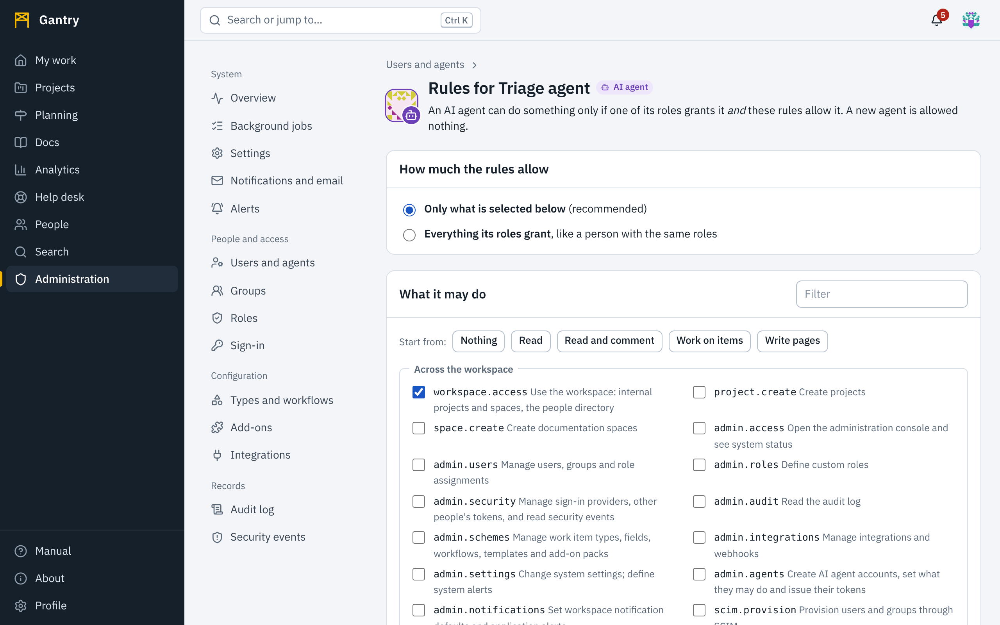

An **AI agent account** is for software that acts on its own: an assistant that triages requests, a bot that files test failures, a script that reports status. It is a separate kind of account so that people can always tell an agent from a person, and so that you can limit an agent more tightly than a person.

## What is different about an agent

| | A person | An AI agent |
| --- | --- | --- |
| Signs in with | Password or single sign-on, in a browser | API tokens only. It cannot use the sign-in page. |
| Shown as | Name and picture | Name with an **AI agent** badge and a robot mark on its picture, everywhere |
| May do | Whatever its roles grant | Only what its roles grant **and** its rules allow |
| Starts with | Its roles | **Nothing**: the rules of a new agent allow nothing |
| Receives | Notifications in the application and by email | Notifications in the application only (readable through the API). It never receives email. |
| Responsible | Themselves | The administrator who created it is recorded as responsible |

## Create an agent

Needs the *admin.agents* permission.

1. Open **Administration**, **Users and agents**, **New agent**.
2. **Name** it for what it does: *Request triage agent*. The name is shown wherever it acts.
3. Fill in **What this agent is for**. It is shown on the agent's profile, so people know what is acting on their work.
4. Choose a **global role**. *Member* is usual for an agent that works inside the workspace; the rules decide how much of it is usable.
5. Press **Create**. You are taken to its rules.

## Write its rules

Open **Manage**, **Rules: what it may do** on the agent's row.

> **Important**: an AI agent can do something only if one of its **roles grants it** *and* these **rules allow it**. Rules never add access; they only take it away. A new agent is allowed nothing.

### How much the rules allow

- **Only what is selected below** is the normal setting.
- **Everything its roles grant** lifts the rules: the agent can do whatever its roles allow, in every project and space those roles cover. Use it only for an integration you operate yourself, such as directory provisioning. Lifting the rules needs an administrator who manages sign-in security (*admin.security*), and such agents are flagged **No rules** in the list.

### What it may do

Select the permissions the agent may use. They are grouped as **Across the workspace**, **In projects** and **In documentation spaces**, with a filter box.

**Start from** fills in a common set that you can then adjust:

| Preset | Allows |
| --- | --- |
| **Nothing** | Signing in to the API, and nothing else. |
| **Read** | Seeing work and pages where its roles allow, and searching. |
| **Read and comment** | Also taking part in discussions. |
| **Work on items** | Also creating, changing, moving and being assigned work items. |
| **Write pages** | Reading everything it may, and creating and editing pages. |

Permissions that matter most for reading and writing data:

| To let the agent | Select |
| --- | --- |
| Use the workspace at all: internal projects and spaces, the directory | `workspace.access` |
| Read projects, work items and service desk requests | `project.view` |
| Post messages | `item.comment` |
| Create work items | `item.create` |
| Change fields, including dates and the description | `item.edit` |
| Move items through the workflow | `item.transition` |
| Assign items | `item.assign` |
| Link items | `item.link` |
| Archive items | `item.delete` |
| Work service desk queues and read or write internal notes | `desk.agent` |
| Read documentation pages | `space.view` |
| Create and edit pages | `page.edit` |

A permission marked *Allowed here, but none of its roles grants it, so it has no effect yet* needs a role as well: give the agent a role in the project or space concerned.

You cannot allow an agent a workspace-wide permission that you do not hold yourself.

### Where

- **Projects**: select the projects the agent may work in, or **Every project it has a role in**.
- **Spaces**: select the documentation spaces, or **Every space it has a role in**.

The agent also needs a role in each project or space, given there as for anyone else. This list narrows it further: an agent that is a member of five projects but whose rules name two can see only those two. Projects and spaces left unselected do not exist as far as the agent can tell.

"A role in" includes the access every member has: a project or space set to *Everyone in the workspace* counts for an agent with the Member role when you choose **Every project** or **Every space**, so prefer ticking the ones you mean.

### How fast

**Requests per minute** sets the agent's own limit. Leave it empty to use the limit for all API clients. A lower number contains an agent stuck in a loop.

### Its roles

The page lists the roles the agent holds and where. *This agent has no role anywhere, so it can do nothing whatever the rules say* means you still need to give it one.

Press **Save rules**. The change takes effect on the agent's next request. Every change to an agent's rules is recorded in the audit log with the rules before and after.

## Issue a token

Open **Manage**, **API tokens**, **New token** on the agent's row. Choose what the token may do and when it expires, and copy it; it is shown once.

A token narrows the agent further: a *Read only* token cannot change anything whatever the roles and rules say. So the three layers are:

1. **roles**: what the account is granted, and where;
2. **rules**: which of that an agent may use, and in which projects and spaces;
3. **token**: which of that this one credential may use.

An action is allowed only if all three allow it.

## What the agent sees

- **Through the API**: lists return only what the agent may see, and are simply empty when that is nothing. A single item, project or page it may not see answers *not found*, the same answer as for one that does not exist. A change it may not make answers *forbidden* and is recorded as a security event.
- **Through MCP**: the agent is offered only the tools its roles, rules and token allow. An agent allowed only to read is not offered the tools that write. A tool that is not offered also refuses if it is called anyway.
- **In text**: links and mentions an agent writes resolve only to what the agent may see, and the agent sees links in other people's text only to what it may see.
- **Notifications**: an agent is told about assignments and mentions only for work it is able to open.

## Examples

**A triage agent for one service desk.** Roles: *Service agent* in the project IT. Rules: preset *Work on items*, plus `desk.agent`; **Projects**: IT only; **Spaces**: the knowledge base only, with `space.view`. Token: *Read and change content*, 90 days. It can read and answer requests in IT, assign them, write internal notes and read the knowledge base. It cannot see any other project.

**A reporting agent.** Roles: *Member*. Rules: preset *Read*; **Every project it has a role in**; no spaces. Token: *Read only*. It can read the work in every project that is open to members and nothing else, and it cannot change anything.

**A documentation assistant.** Roles: *Space editor* in the space ENG. Rules: preset *Write pages*; **Spaces**: ENG only; no projects. It can read and write pages in ENG and cannot see any work item.

## Keep agents under review

- The **Kind** filter on **Users and agents** lists the agents. **No rules** marks any whose rules were lifted.
- Each token shows when it was **last used**. Revoke tokens that are idle; give each integration its own token so that one can be revoked without stopping the others.
- **Audit log**: filter by the agent's name to see everything it did. Entries by agents carry the *AI agent* badge.
- **Security events** lists what agents were refused. A burst of refusals from one agent usually means its rules are narrower than its instructions; decide which of the two is wrong.
- **Deactivate** an agent to stop it at once: its tokens stop working and its name stays on everything it did.
- An alert rule on security events can tell you when refusals spike. See [Notifications, email and alerts](notifications.md#alerts).

## If an agent misbehaves

1. **Deactivate** it (or revoke its token). This is immediate.
2. Read what it did in the **audit log**; each work item's **History** shows the changes field by field, and page history can restore earlier versions.
3. Narrow its rules before turning it back on.

Text that an agent reads from work items and pages was written by other people and may try to instruct it. Rules are the control that holds even then: an agent cannot be talked into an action its rules do not allow.
