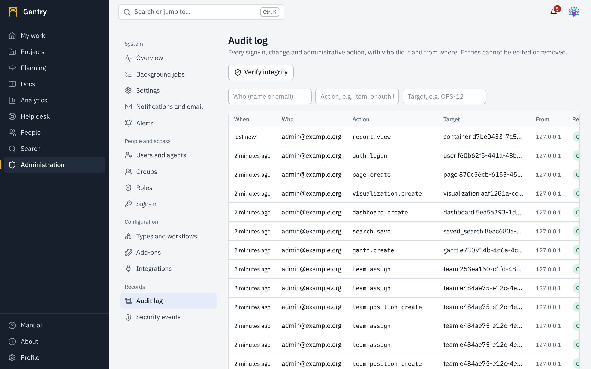

## The audit log

Every sign-in and sign-out, every change to work, pages, settings, roles, tokens and integrations, and every administrative command is recorded with:

- **when** it happened;
- **who** did it, and how they were authenticated: a browser session, an API token (with the token's name) or the command line. An entry made by an AI agent account carries the **AI agent** badge next to the name; an entry made by a person through a token carries **Token**;
- the **action**, such as `item.transition` or `role.grant`;
- the **target**;
- the address it came **from**;
- the **result**.

Select a row to see the full entry, including what changed and the request ID that ties it to the server logs.

Filter by **who** (part of a name or an email address; AI agents are found by their names), by **action** (type the beginning, for example `role.` or `auth.login`) and by **target** (for example `OPS-12`).

### The record cannot be edited

Entries can only be added. The database refuses changes and deletions, and each entry carries a fingerprint computed from its content and the previous entry's fingerprint. Altering or removing any entry breaks the chain from that point on.

Press **Verify integrity** to recompute the chain. The result says how many entries were checked and that the chain is unbroken, or identifies the first entry that does not match. A system administrator can run the same check from the command line and schedule it: see [Security](../sysadmin/security.md).

### Useful reviews

| Question | Filter by action |
| --- | --- |
| Who gained or lost access? | `role.` and `user.` |
| Which tokens were created or revoked? | `token.` |
| Who changed how sign-in works? | `auth_provider.` and `settings.` |
| What did a particular AI agent do? | Filter **who** by the agent's name |
| Who changed what an AI agent may do? | `agent.policy_update`; the entry holds the rules before and after |
| Who read a report that names people? | `report.view` |
| Who changed a shared visualization's script? | `visualization.update` |
| Who changed notification defaults or alerts? | `settings.` and `alert.` |
| Who changed a team or someone's time in a position? | `team.` |
| Who threw away unsaved text in a shared editor? | `draft.discard`; the target names the page, item or script |
| What was done from the command line? | Entries whose *who* is *system* |

## Security events

Security events are the things that were **refused or look wrong**: wrong passwords, lockouts, requests without a valid anti-forgery token, invalid or expired API tokens, attempts to do something without permission, and webhook calls with a bad signature. The chips above the table count each kind in the last 24 hours; select one to filter.

What to look for:

- **A burst of failed sign-ins for one account**: someone is guessing a password. The account locks itself; confirm with its owner, and consider requiring single sign-on.
- **Failed sign-ins across many accounts from one address**: password spraying. The address is throttled automatically; your system administrator can block it at the network edge.
- **Repeated permission denials by one user or agent**: a misconfigured script, or someone probing. Talk to the owner; for an agent, review its roles and revoke its token if in doubt.
- **Rejected webhook signatures**: a secret is out of step, or someone else is calling the address.
- **Anything marked critical**: tell your system administrator at once.

When an account may be compromised: **Sign out everywhere**, revoke its tokens, reset its password or deactivate it, then read its audit entries from before the incident to see what was done.
