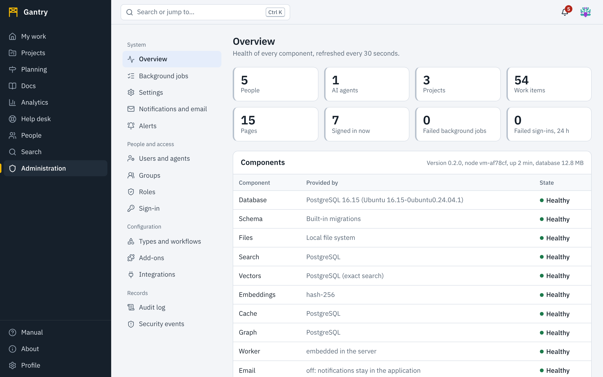

Open **Administration** in the rail. You see it only if you hold a role that grants *Open the administration console*.

## Sections

| Section | What you do there | Permission needed |
| --- | --- | --- |
| Overview | See the health of every component, the server nodes, and the size of the installation. | `admin.access` |
| Background jobs | See queued, running and failed jobs; retry a failed one. | `admin.access` |
| Settings | Site name, announcement, sign-in notice, the support contact, the statements people can read, profile rules; read the server's configuration. See [Site, support and statements](site.md). | `admin.settings` (profile rules: `admin.users`) |
| Notifications and email | Defaults for each kind of notification, reminders, and whether mail is being delivered. See [Notifications and alerts](notifications.md). | `admin.notifications` |
| Alerts | Conditions that are watched every minute, and who is told. | `admin.notifications` for application alerts, `admin.settings` for system alerts |
| Users and agents | Create people and AI agents, assign roles, edit profiles, unlock, deactivate. See [Users, groups and roles](users.md). | `admin.users` |
| AI agent rules | Decide what each AI agent may read and change. See [AI agents](agents.md). | `admin.agents` |
| Groups | Group accounts so that roles are given once. | `admin.users` |
| Roles | Read the built-in roles; create custom ones. | `admin.roles` |
| Sign-in | Connect identity providers (OpenID Connect, SAML 2.0) and automatic provisioning (SCIM). See [Sign-in and provisioning](sign-in.md). | `admin.security` |
| Types and workflows | Define work item types, their fields and workflows. See [Types and workflows](schemes.md). | `admin.schemes` |
| Add-ons | Install content packs. | `admin.schemes` |
| Integrations | Slack, Microsoft Teams, GitHub, GitLab, Jira import, webhooks. | `admin.integrations` |
| Audit log | Who did what, when, from where. | `admin.audit` |
| Security events | Failed sign-ins, denied actions, rejected signatures. | `admin.security` |

Some things an application administrator looks after are outside the console, next to the work they concern:

| What | Where | Permission needed |
| --- | --- | --- |
| Hierarchy levels, programs and initiatives | **Planning** | `planning.manage` |
| Any team, its positions and members | **People**, **Teams** | `team.manage` |
| Sharing dashboards and visualizations with the workspace | **Analytics** | `analytics.share` (members have it; remove it from a custom role to restrict sharing) |

## Who is an administrator

Three built-in roles reach the console.

- **System administrator**: everything, including every project and space whatever its visibility.
- **Application administrator**: users, groups and roles, AI agents and their rules, notification defaults and application alerts, types and workflows, add-ons, integrations, the hierarchy, teams and the audit log. Not site settings, sign-in configuration, system alerts or security events, and no special access to private projects. Give this to the people who look after the day-to-day shape of Gantry.
- **Auditor**: reads the audit log and security events, and can read, but not change, every project and space including private ones. Give this to compliance or security reviewers.

Keep at least two system administrators, so that one can restore the other's access. The command line can always create one when none can sign in: see [the command-line tool](../reference/cli.md).

## Overview

The top row counts people, AI agents, projects, items and pages. **Components** lists each part of the system, what provides it on this installation, and whether it is healthy: the database, file storage, search, the cache, background jobs, email, live updates and the rest. **Nodes** lists each server process that has reported recently, with its role, version, when it started and when it last reported; in an installation with several servers this is where you see that all of them run the same version. A component that is not healthy shows the reason; pass it to your system administrator, who will find the detail in [the logs](../sysadmin/logs.md).

## Settings

Site name, announcement, sign-in notice, time zone, the support contact shown on error pages, the privacy and other statements, and which profile fields people may change are described in [Site, support and statements](site.md).

**Server configuration** shows the settings the server is running with. They are changed in the server's configuration file by a system administrator; secrets are never shown.

## Background jobs

Sending email, posting to chat, calling webhooks, building search embeddings and importing from Jira happen in the background. A job that fails is retried with increasing delays; when it has used all its attempts it is listed here as failed with its last error. Fix the cause (for example a revoked webhook address), then press **Retry**.
