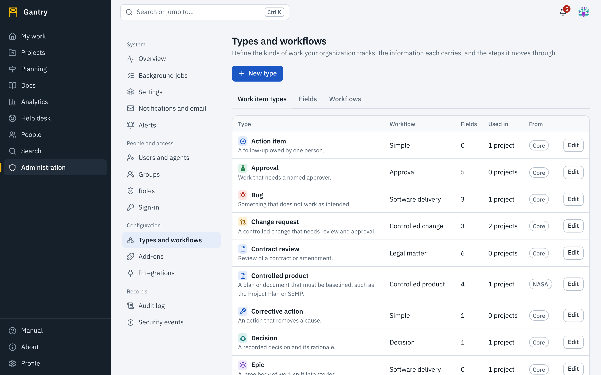

Everything Gantry tracks is described by data you can change: **fields** hold information, **workflows** define steps, and **work item types** combine a workflow with a set of fields. Open **Administration**, **Types and workflows**.

The **From** column says where a definition came from: *Core* (shipped with Gantry), an add-on's name, or *Customized* when an administrator changed it. Upgrades update Core and add-on definitions and **never overwrite a customized one**.

## Fields

A field is one piece of information on an item.

| Kind | Holds |
| --- | --- |
| Short text, Long text | Words. Long text accepts Markdown. |
| Number | A number, with decimals. |
| Date | A calendar date. |
| One choice, Several choices | Values from a list you define. |
| Person | A user or agent. |
| Link | An `http` or `https` address. |
| Yes / no | A select box. |

Press **New field**, give it a name, a kind and, for choices, the list of values. The **help text** appears under the field on forms: use it to say what a good answer looks like.

Fields are shared. *Severity* can be used by bugs, incidents and hazards, and then a list or report across all three means the same thing.

## Workflows

A workflow has **statuses** and **steps**.

- Every status belongs to one of three stages: *Not started*, *In progress* or *Done*. Stages drive colors, the *All work* board, open-item counts and service-level clocks, so choose them with care.
- A step has a **button** label, the statuses it may be taken **from** (or any), the status it leads **to**, and optionally the fields it **needs**. An item cannot take the step until those fields are filled in.

To add one, press **New workflow** on the Workflows tab. Workflows are **drawn**: each status is a box, each step an arrow between two boxes, and several arrows leaving one box are a branch. Add statuses, drag from one box to another to allow a step, name it, and choose the fields it needs. A list of the statuses and steps beneath the canvas offers the same controls for keyboard and screen-reader use. [Workflows](../user/workflows.md) in the user guide describes the editor in full; it is the same one project administrators use.

Keep it short. Five statuses that people keep up to date are worth more than twelve that they do not.

Changing a shared workflow takes effect at once in every project that uses it. If you remove a status that items may be in, the editor asks which status those items move to, and records the move in each item's history; nothing is left in a status that no longer exists.

**Projects can have workflows of their own.** A project administrator can give one type of work in their project its own workflow, starting from a copy of the shared one (the project's **Settings**, **Workflows**). From then on your changes to the shared workflow do not reach that type in that project, until the project returns to the shared workflow. Shared workflows are therefore the default and the standard, not a constraint: use them to set the pattern, and let projects diverge where the work really differs.

Example, a document approval:

| Step | From | To | Needs |
| --- | --- | --- | --- |
| Submit | Draft | In review | Approver |
| Approve | In review | Approved | |
| Send back | In review | Draft | |
| Publish | Approved | Published | Effective date |

## Work item types

A type has a name, an icon and color, a workflow, and the fields shown on its form with those that are required when an item is created.

Press **New type**, choose its workflow and add fields. Then add the type to projects: each project chooses which types it offers, in its settings.

## Changing what a project uses

Types, fields and workflows are defined once for the whole installation; a **project** only chooses which types it offers. This keeps a *Risk* the same thing everywhere while letting each team work with the set it needs. See [Projects and templates](projects.md).

## Sharing your definitions

Definitions can be packaged as a **pack**, a single file that another Gantry installation can install. The format is described in [Packs](../reference/packs.md).

## The hierarchy above and within projects

Which levels exist above projects (programs, initiatives, or your own names), which level each work item type is on, and whether the order is enforced, are set under **Planning**, **Levels**, by people with the *planning.manage* permission. Application administrators have it. See [Planning](../user/planning.md#the-hierarchy).

When you add a work item type, decide its level there too: an *Epic* above *Story* above *Task* nests the same way in every project, graph, report and Gantt chart.
