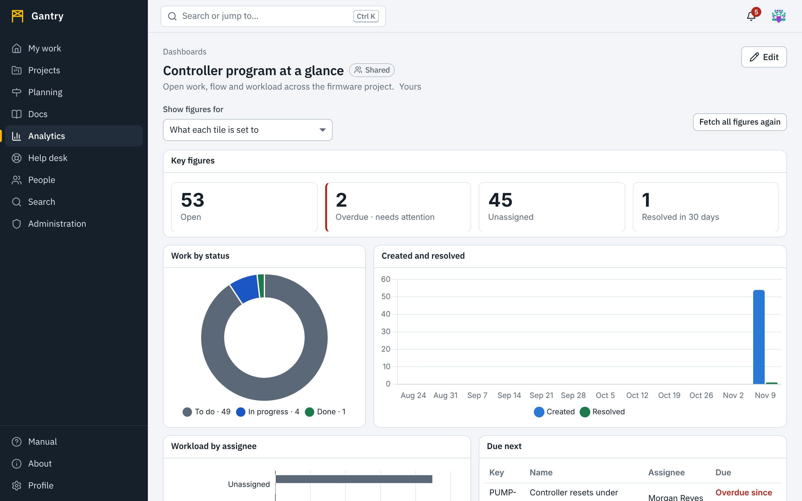

**Analytics** has two parts.

- A **dashboard** is a page of tiles. Each tile shows one visualization.
- A **visualization** is one chart, table or set of figures. Some are built in. Others are written by you or your colleagues, saved in the **library**, and used on any number of dashboards and in documents, messages and requests.



Every figure is counted for the person looking: a dashboard shared with the whole workspace shows each person only the work they have access to.

## Dashboards

### Create one

1. Open **Analytics** and press **New dashboard**. Give it a name. It is yours alone until you share it.
2. Press **Edit**, then **Add a tile**, and choose from **Saved visualizations** (yours and shared ones), **Built-in**, or **Write a visualization of your own**.
3. Repeat. New tiles are placed beside or beneath the others. Press **Done** when the dashboard looks right.

### The built-in visualizations

| Name | Shows | Drawn with |
| --- | --- | --- |
| **Key figures** | Open, overdue, unassigned and recently resolved work as four numbers | HTML |
| **Work by status** | To do, in progress and done as a doughnut | Chart.js |
| **Created and resolved** | Work created and resolved per week, side by side | Chart.js |
| **Open work over time** | How much was unfinished at the end of each week | Chart.js |
| **Open work by priority** | Horizontal bars from none to critical | Apache ECharts |
| **Work by type** | A treemap of work item types by count | Apache ECharts |
| **Workload by assignee** | Open work per person or AI agent, split by status, with overdue alongside | Apache ECharts |
| **Activity calendar** | Work created per day as a calendar heat map | Apache ECharts |
| **Time to resolve** | Days from creation to resolution for each resolved item, with the median and the 85th percentile | Plotly |
| **Labels** | Labels as bubbles sized by the open work that carries them | D3 |
| **Projects, types and status** | Nested rings: project, then type, then status | D3 |
| **Due next** | The open work with the nearest due dates, as a table | HTML |

Each one is also a worked example: open it in the library to read its script under **How it is written**, and press **Make a copy to change** to start your own from it.

### Arrange the tiles

Press **Edit** to arrange a dashboard you own or are an editor of. Every change is saved as you make it.

- **Move** a tile by dragging its handle (the grip at the top left). **Resize** it by dragging its lower right corner. Tiles snap to a grid of twelve columns; tiles in the way move down.
- With the keyboard: focus the handle, then the **arrow keys** move the tile and <kbd>Shift</kbd> with the arrow keys changes its size.
- **Close the gaps between tiles** slides everything up.
- The tile's menu has **Title and parameters…**, **See how it is written** and **Remove from the dashboard**.

On a phone the tiles are stacked in one column in reading order.

### Parameters: one chart, many uses

Most visualizations take **parameters**. The built-in ones take **project** (a project key, or empty for everything you can see); some take more, such as the number of weeks.

- **Per tile**: **Title and parameters…** sets the tile's own values. The same *Work by status* chart can appear three times, once per project.
- **For the whole dashboard**: **Show figures for** at the top switches every tile to one project at once. *What each tile is set to* returns to the tiles' own values. The choice is yours alone and lasts while you have the dashboard open; **Keep this choice for everyone** saves it as the dashboard's own (editors only).

### Fresh figures

A dashboard refreshes by itself: when work changes in a way that could alter the figures, the tiles fetch them again within about ten seconds. **Fetch all figures again** does it at once.

### Share a dashboard

Open **Dashboard settings**.

| Setting | Effect |
| --- | --- |
| **Who can see it** | *Only me and the editors below*, or *Everyone in the workspace*. Sharing with the workspace needs the permission to share analytics, which members have unless your administrator removed it. |
| **Who can change it with me** | Editors can add, move, resize and remove tiles. Several people can edit at once and see each other's changes as they happen; see [Working at the same time](together.md). |

Only the owner can change the sharing or delete the dashboard.

> **Note**: a tile that shows someone else's **private** visualization appears to other viewers as *This visualization is private to someone else, or was deleted*. Share the visualization as well as the dashboard.

## The visualization library

**Analytics**, **Visualizations** lists the built-in visualizations, your own, and the ones shared with the workspace. This is where you view, edit, copy, share and delete them.

Open one to see:

- the **script** (or HTML), in an editor with highlighting;
- a **preview** that runs it with your own access, in the current theme;
- **About it**: its description and the library it is written with;
- **Parameters**: the names and default values the script reads;
- **Sharing**: who can use it and who can change it with you;
- **In a document, a comment or a ticket**: the line to paste where the chart should appear, for example `![[viz:3f0c…|320]]`. The number is the height in pixels. See [Writing](writing.md#charts-and-custom-content).

**Add to a dashboard** puts it on one of the dashboards you can edit.

If a visualization is not yours to change, you can still read how it is written and try changes in the preview; **Save a copy** keeps them as your own.

## Write your own

Press **New visualization**, name it, and choose what to write it with:

| Library | Choose it for |
| --- | --- |
| **Chart.js** | The quickest way to a common chart: bars, lines, doughnuts, radar. |
| **Apache ECharts** | Many more chart types (treemap, heat map, sankey, gauge, calendar) with sensible defaults. |
| **Plotly** | Statistical and scientific charts: scatter with marginals, box plots, histograms, 3D. |
| **D3** | Full control. You draw every mark yourself. |
| **HTML and script** | No library: figures, tables, or anything you build from markup. |

You start from a small working example and change it. Press <kbd>Ctrl</kbd> <kbd>Enter</kbd> to run the script in the preview; **Save** keeps it.

### The shape of a script

A script is the body of an asynchronous function. It fetches data, draws into `gantry.root`, and tells Gantry how to clean up.

```js
// 1. Fetch. The request is made as the person looking at the chart.
const data = await gantry.api.get('/api/v1/analytics/items', {
  project: gantry.params.project,   // empty: everything the viewer can see
  group_by: 'type',
});

// 2. Draw into gantry.root, using the theme's colors.
const canvas = gantry.root.appendChild(document.createElement('canvas'));
canvas.setAttribute('role', 'img');
canvas.setAttribute('aria-label',
  'Work items by type: ' + data.groups.map(g => g.value + ' ' + g.label).join(', '));
const chart = new Chart(canvas, {
  type: 'bar',
  data: {
    labels: data.groups.map(g => g.label),
    datasets: [{ label: 'Work items', data: data.groups.map(g => g.value),
                 backgroundColor: gantry.colors.series[0], maxBarThickness: 24 }],
  },
  options: { maintainAspectRatio: false, plugins: { legend: { display: false } } },
});

// 3. Clean up when the tile is redrawn or removed.
gantry.cleanup(() => chart.destroy());
```

The same chart with each of the other libraries:

```js
// Apache ECharts
const data = await gantry.api.get('/api/v1/analytics/items', { project: gantry.params.project, group_by: 'type' });
const chart = echarts.init(gantry.root, null, { renderer: 'svg' });
chart.setOption({
  aria: { enabled: true },
  xAxis: { type: 'value', minInterval: 1 },
  yAxis: { type: 'category', inverse: true, data: data.groups.map(g => g.label) },
  series: [{ type: 'bar', data: data.groups.map(g => g.value), barMaxWidth: 22,
             itemStyle: { color: gantry.colors.series[0] } }],
});
gantry.onResize(() => chart.resize());
gantry.cleanup(() => chart.dispose());
```

```js
// Plotly
const t = await gantry.api.get('/api/v1/analytics/timeline', { project: gantry.params.project, interval: 'week', periods: 16 });
const el = gantry.root.appendChild(document.createElement('div'));
el.style.cssText = 'width:100%;height:100%';
Plotly.newPlot(el, [
  { x: t.periods.map(p => p.start), y: t.periods.map(p => p.created),  name: 'Created',  mode: 'lines' },
  { x: t.periods.map(p => p.start), y: t.periods.map(p => p.resolved), name: 'Resolved', mode: 'lines' },
], { margin: { l: 40, r: 12, t: 8, b: 36 }, paper_bgcolor: 'rgba(0,0,0,0)', plot_bgcolor: 'rgba(0,0,0,0)',
     font: { color: gantry.colors.text } }, { displayModeBar: false, responsive: true });
gantry.onResize(() => Plotly.Plots.resize(el));
gantry.cleanup(() => Plotly.purge(el));
```

```js
// D3
const data = await gantry.api.get('/api/v1/analytics/items', { project: gantry.params.project, group_by: 'priority', open: true });
const { width, height } = gantry.size;
const y = d3.scaleBand().domain(data.groups.map(g => g.label)).range([8, height - 8]).padding(0.35);
const x = d3.scaleLinear().domain([0, d3.max(data.groups, g => g.value) || 1]).range([80, width - 36]);
const svg = d3.select(gantry.root).append('svg').attr('viewBox', [0, 0, width, height])
  .attr('role', 'img').attr('aria-label', 'Open work by priority');
const row = svg.selectAll('g').data(data.groups).join('g').attr('transform', d => `translate(0,${y(d.label)})`);
row.append('rect').attr('x', 80).attr('width', d => x(d.value) - 80).attr('height', y.bandwidth()).attr('fill', gantry.colors.series[0]);
row.append('text').attr('x', 72).attr('y', y.bandwidth() / 2).attr('dy', '0.35em').attr('text-anchor', 'end').attr('fill', gantry.colors.text).text(d => d.label);
```

An **HTML** visualization is markup; its `<script>` elements run in order and have the same `gantry` object:

```html
<p id="n" style="font: 600 40px system-ui; margin: 0"></p>
<p style="color: var(--muted); margin: 0">open work items</p>
<script>
  gantry.api.get('/api/v1/analytics/summary', { project: gantry.params.project })
    .then(s => { document.getElementById('n').textContent = gantry.formatNumber(s.open); });
</script>
```

### Getting project data

`gantry.api.get(path, query)` is the only way a script gets data. It performs a **GET** under `/api/v1/` and resolves to the JSON. These paths are made for charts:

| Path | Returns |
| --- | --- |
| `/api/v1/analytics/summary` | `total`, `open`, `todo`, `in_progress`, `done`, `overdue`, `unassigned`, `created_30d`, `resolved_30d`, `projects` |
| `/api/v1/analytics/items` | `groups`: a list of `{ key, label, value, open, done, path }`, and `total`. Choose the grouping with `group_by`. |
| `/api/v1/analytics/timeline` | `periods`: a list of `{ start, created, resolved, open_at_end }` |
| `/api/v1/analytics/workload` | `people`: a list of `{ person, todo, in_progress, open, done_30d, overdue, estimate_open }` |
| `/api/v1/analytics/cycle-time` | `items`: `{ key, title, type_key, resolved_at, days }` for each resolved item, and `stats`: `count`, `average`, `median`, `p85` |
| `/api/v1/items/query` | Work items that match criteria, the same search as [Find work](search.md): pass `{ q: JSON.stringify({ criteria, sort, limit }) }` |

All the analytics paths accept `project` (a project key) or `container` (the id of a program or initiative). Without either they cover everything the viewer can see. Parameters, limits and every grouping are listed in [the visualization reference](../reference/visualizations.md). Any other GET path in [the API reference](../reference/api.md) works too: a script can read whatever the viewer could read.

### What is in scope

| Name | What it is |
| --- | --- |
| `gantry.root` | The element to draw in. It fills the tile. |
| `gantry.size` | `{ width, height }` of the tile in pixels. |
| `gantry.params` | The parameter values: the visualization's defaults, overridden by the tile and by the dashboard's **Show figures for**. |
| `gantry.colors` | Colors of the viewer's theme: `text`, `muted`, `grid`, `background`, `accent`, `todo`, `progress`, `done`, and `series`, eight colors to use in order. |
| `gantry.theme` | `'light'` or `'dark'`. The script runs again when the viewer switches. |
| `gantry.formatDate(value, options)`, `gantry.formatNumber(value, options)` | Dates and numbers in the viewer's language and time zone. |
| `gantry.onResize(fn)` | Called when the tile changes size. |
| `gantry.cleanup(fn)` | Called before the script runs again and when the tile goes away. Destroy charts and timers here. |
| `Chart`, `echarts`, `Plotly`, `d3` | The library you chose. Only that one is loaded. |

### What a script may and may not do

A visualization runs in a **sealed frame**, in the browser of the person looking at it. The server stores the script and never runs it.

| A script can | A script cannot |
| --- | --- |
| Read data with `gantry.api.get`, as the viewer | Change anything: only GET is carried out, and the server refuses anything else from a script |
| Draw anything inside its tile | Read or change the page around it, other tiles, or the viewer's session |
| Use the one library it chose | Load scripts, styles, fonts or images from other sites |
| Keep state in variables while it is on screen | Use cookies or browser storage |
| | Contact any server: every network connection from the frame is blocked |
| | Open windows, submit forms, or navigate the page |

Because a script runs **as each viewer**, a chart you share never shows anyone more than they could see themselves, and it may show different numbers to different people. Say so in its description when that matters.

> **Important**: sharing a script with the workspace means other people's browsers will run it with their access to read data. Gantry's frame keeps that data from leaving the browser, and every change to a shared script is recorded in the audit log with its author. Still, share only scripts you have read and understand, and treat a request to "just paste this script" like any other request to run someone else's code. Your system administrator's guide describes the technical limits of the frame in [Security](../sysadmin/security.md#custom-content-and-scripts).

### Make it good

- **Use the theme's colors.** Take colors from `gantry.colors` so the chart reads in light and dark. Use `series` in order, and never rely on color alone: label the marks or add a legend.
- **Say it in words.** Give a canvas or SVG `role="img"` and an `aria-label` that states the numbers, as the examples do. Screen-reader users get the label, not the picture.
- **Fit the tile.** Use `gantry.size` or the library's own resizing with `gantry.onResize`. Tiles are resized by their users.
- **Clean up.** Without `gantry.cleanup`, a chart that is redrawn leaves the old one behind.
- **Use parameters** for anything a reader might want to change: the project, a number of weeks, a label. A parameter named `project` is filled in by the dashboard's **Show figures for**.
- **Keep it small.** A script can be up to 200,000 characters, but the best ones fit on a screen.

### When a script fails

The tile shows the error in place of the chart, for example *data.groups is undefined* or *Custom content can read only addresses under /api/v1/*. Open the visualization and run it in the preview to see the same message while you fix it. If a tile has drawn nothing after ten seconds it says *Still fetching the data for* and its name; a script that never finishes does not affect the rest of the dashboard.
