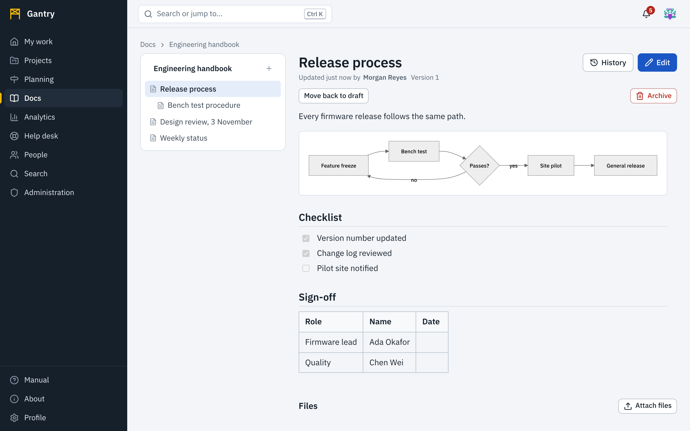
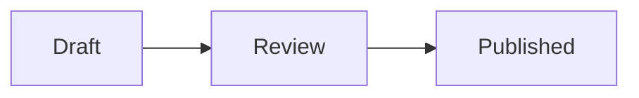
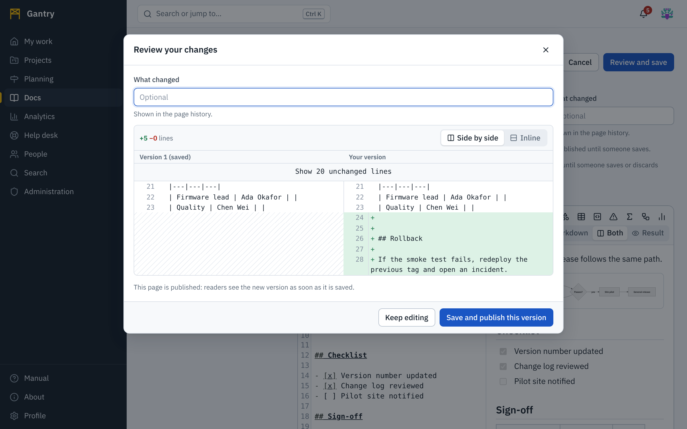

## Spaces and pages

**Docs** lists the spaces you can read. A space belongs to a team or a subject and holds a tree of pages. Open a space to see its pages on the left and the selected page on the right.

To create a space press **New space**, give it a name and a key, choose its kind (**Documentation** or **Knowledge base**) and who can read it.

## Write a page

1. In a space press **New page**. To place it under another page, open that page first and use **New page** there.
2. Enter a **title** and optionally start from a **template**: meeting notes, decision record, how-to, runbook, incident review and others.
3. Write, then press **Publish page**. **Save as draft** keeps it visible to editors only until you publish.

There are two editors. Switch between them with **Simple** and **Advanced** above the text. The text is the same Markdown either way.

### The simple editor

The simple editor works like a word processor. Use the toolbar for headings, bold and italic, lists, checklists, quotes, links, tables and code blocks. Keyboard shortcuts such as <kbd>Ctrl</kbd> <kbd>B</kbd> work, and so does typing Markdown: `## ` starts a heading, `- ` a list.

### The advanced editor

The advanced editor shows the page's **Markdown** and, beside it, the result as you type. It is the same editor used for descriptions and messages, with everything described in [Writing](writing.md): mentions, links to work items, dates from a calendar, attached files and pictures with a chosen size, sound and video players, drawn diagrams, Mermaid diagrams, formulas, callouts, footnotes, a table of contents, live charts and custom HTML or SVG.

A page that contains something the simple editor would lose (a diagram, footnotes, a chart, raw HTML) can only be opened in the advanced editor, and the **Simple** button says why.

## Review your changes before publishing

Editing a page that already exists does not save in one step. Press **Review and save**: Gantry shows what you changed, and nothing is saved until you confirm.

- Lines you **added** are green and marked `+`; lines you **removed** are red and marked `−`. Within a changed line, the changed words are marked more strongly, so a one-word edit in a long paragraph is easy to find. Color is never the only signal: the `+` and `−` signs carry the same meaning.
- The count at the top (**+12 −3 lines**) tells you the size of the change.
- **Side by side** puts the saved version on the left and yours on the right, with matching lines next to each other. **Inline** shows one column with removed lines followed by added ones. On a phone or a narrow window the comparison is always inline.
- Long unchanged stretches are folded to a line you can open.
- If you changed the title, the old and new titles are shown above the text.
- Fill in **What changed**. The note appears in the page's history and helps the next reader.

Press **Save and publish this version** to save (for a draft the button reads **Save page**), or **Keep editing** to go back with your text untouched. For a published page the dialog reminds you that readers see the new version as soon as it is saved.

## Several people, one page

When several people open the same page in the editor, they write in the same text. Everyone's cursor is shown with their name, and their pictures appear next to the Cancel button. Nothing is published until one of them presses **Review and save**; the review then shows everything the group changed since the last saved version. See [Working at the same time](together.md).

Shared editing happens within one editor, the one the page was last saved with. While others are editing, the button for the other editor is unavailable to you. If you switch editors when nobody else is there, you leave the shared session, and the page says *You are editing on your own. Others will see your changes when you save.*

**What you type and do not save is kept as a draft.** If you leave the editor with **Cancel**, the page readers see is unchanged, and the text you typed waits in the editor: whoever opens it next, you or a colleague, continues from there, and the editor says *There are changes that are not saved*. A draft that nobody touches is dropped after 30 days. To throw it away sooner, press **Discard changes** in the editor: after you confirm, everything typed since the last saved version is removed and the editor starts again from the saved page. Discarding is unavailable while someone else is editing, and it is recorded in the audit log.

If the live connection is not available, the editor says so and you edit on your own. In that case, if someone else saves first, your save is refused with a message, and **your text stays in the editor**: open the latest version in a new tab, copy over what you need, and reload. Nothing is overwritten silently.

## History

**History** lists every saved version with its author, time and note.

- **View** shows an old version.
- **Changes** opens the same colored comparison as the review, between that version and the one before it.
- **Restore** makes an old version the newest one, without removing anything in between.

## Stages before publishing

A space's administrator can make pages go through stages, for example *Draft → In review → Published*, with named steps between them (*Send for review*, *Send back*, *Publish*). In such a space a new page starts at the first stage, the page shows its stage and the steps allowed from there, and readers see a page only once it reaches a stage that counts as done. Until then only editors see it.

The stages are drawn in the same [workflow editor](workflows.md) used for projects, under **Space settings**, **Stages a page goes through**. A space without stages has the two built in: draft and published.

## Link pages and work

To refer to work from a page, type the item's key (`PUMP-12`) or `[[` and choose it; to refer to another page, type `[[` and its title. See [Writing](writing.md#link-work-projects-and-pages). The page itself lists the **work items that link here**, so readers can go from a procedure or design to the work that depends on it, and the files attached to it under **Files**.

## Knowledge base pages

In a knowledge base space, a page has one more switch: **Shown in the help desk**. Turn it on for articles written for customers. They are suggested to people while they describe a request.

## Space settings

A space administrator can rename the space, change who can read it, define the [stages a page goes through](#stages-before-publishing) and manage **members**: viewers read, editors write, administrators manage the space.
