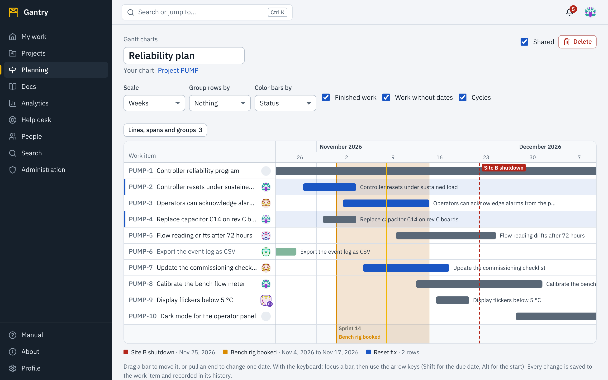

A Gantt chart shows work items as bars on a calendar: where a bar starts is the item's **start date**, where it ends is its **due date**. It is not a picture of the plan: it *is* the plan. Moving a bar changes the work item.

## Where to find one

- **A project**: the **Gantt** tab.
- **A program or initiative**: its **Gantt** tab shows every work item beneath it.
- **Planning**, **Gantt charts**: charts that have been saved, yours and the ones shared with the workspace.

## Reading the chart

- The column on the left names each work item; the bar to its right spans its dates. Select the name to open the item.
- A bar is colored by status unless you choose otherwise. Finished work is drawn lighter.
- An item with only a due date, or only a start date, is drawn as a short marker on that day. An item with neither is listed without a bar.
- The vertical line labeled with today's date is today.
- A project's cycles (sprints) are shown as bands along the bottom.

The bar above the chart sets how it is drawn:

| Control | Choices |
| --- | --- |
| **Scale** | Days, Weeks, Months, Quarters |
| **Group rows by** | Nothing, Project, Assignee, Type, Status, Parent |
| **Color bars by** | Status, Type, Priority, Assignee |

Three check boxes choose what is included: **Finished work**, **Work without dates** and **Cycles**.

Scroll sideways to move through time.

## Change dates on the chart

You can edit a bar if you may edit the work item.

| To | With the mouse or a finger | With the keyboard (bar focused) |
| --- | --- | --- |
| Move the whole item | Drag the bar | <kbd>←</kbd> <kbd>→</kbd>, one day each |
| Change the due date | Drag the right end | <kbd>Shift</kbd> with <kbd>←</kbd> <kbd>→</kbd> |
| Change the start date | Drag the left end | <kbd>Alt</kbd> with <kbd>←</kbd> <kbd>→</kbd> |

The bar follows as you drag, a day at a time; hover over a bar to read its dates and its length in days. When you let go, the dates are saved to the work item at once: the item's page, boards, reminders and other people's charts all show the new dates, and the change is written to the item's **History** with your name.

A due date cannot be moved before the start date. If a save is refused (you lost access, or the connection dropped) the bar returns to where it was and a message says why.

When a colleague has hold of a bar, their picture is shown on it. If two people move the same bar, the later move wins and both are in the history.

## Save a chart and add visual cues

The Gantt tab of a project or program is always there. **Save as a chart** turns the current view into a chart of your own, with a name, that also carries **visual cues**: marks that say something the bars alone do not.

1. On a Gantt tab press **Save as a chart**, or on **Planning**, **Gantt charts** press **New chart** and choose what it shows: one project, or everything beneath a program or initiative.
2. Press **Lines, spans and groups** above the chart. The number on the button says how many the chart has.

| Cue | What it is | Use it for |
| --- | --- | --- |
| **Marker line** | A vertical line on one date, with a label, a color and a style: solid, dashed or dotted. | A deadline, a launch date, a review board, a contract milestone. |
| **Shaded span** | A filled band between two dates, with a label and a color. | A code freeze, a test campaign, a holiday shutdown. |
| **Group** | A colored band behind a chosen set of rows, with a label. Select the rows that belong together, then press **Group the selected rows**. | Sectioning off the items of one work package or one deliverable. |

Eight colors are offered; **Another color** lets you choose any. Each cue has a label, so the meaning never depends on color alone, and every cue is listed beneath the chart with its label and dates.

Cues belong to the chart, not to the work: they are saved with the chart and do not change any work item.

### Who can change what

- The **owner** of a saved chart is the only one who can rename it, change its cues, share it or delete it.
- **Anyone who can open the chart** can move bars for the work items they are allowed to edit, because that edits the work items, not the chart.
- **Shared** makes the chart available to everyone in the workspace. People who open it see only the work items they have access to; the rest of the chart is simply not there for them.

## Tips

- Give work a start date as well as a due date. A bar with both tells you how long something takes; a marker tells you only when it ends.
- Group by **Assignee** to see who is overloaded in a given week.
- Put one **Marker line** on the chart for each date that cannot move, and plan backward from it.
- On a phone the chart scrolls sideways and the names stay in place. Dragging works with a finger; for precise changes, open the item and set the dates there.
