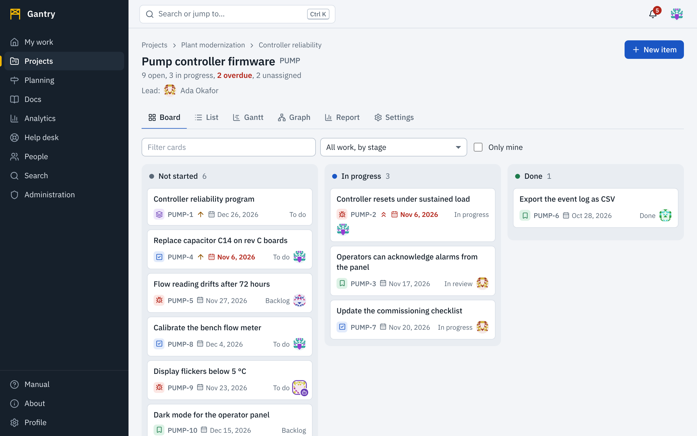

## The screen

- The **dark rail** on the left takes you between areas: My work, Projects, Planning, Docs, Analytics, Help desk, People and Search. Administrators also see Administration. The yellow marker shows where you are.
- The **bar at the top** has the search box, your notifications (the bell) and your account menu, where you change the theme, set your status and sign out.
- On a tablet the rail shrinks to icons. On a phone it becomes a bar of tabs at the bottom of the screen; **More** opens the rest.

Color always means the same thing. Gray is not started, blue is in progress or something you can act on, green is done, amber needs attention soon, red is late or dangerous. Color is never the only signal: a status always has its name next to it.

## Three things to do first

1. **See what is waiting for you.** [My work](my-work.md) lists the items assigned to you and what changed recently.
2. **Find your team's project.** Open [Projects](projects.md), choose the project, and look at its board.
3. **Create something.** Press **New item** in a project, or **New page** in a documentation space.

Then set up [your profile](profile.md): a picture, your time zone, and [which notifications](notifications.md) you want by email.

## Where things are

| You want to | Go to |
| --- | --- |
| See your own work and what changed | [My work](my-work.md) |
| Work on a board, list, Gantt chart or report of one project | [Projects](projects.md) |
| Talk about a piece of work, attach files, see its history | [Work items](work-items.md) and [Writing](writing.md) |
| See how programs, initiatives and projects fit together | [Planning](planning.md) |
| Plan dates on a timeline | [Gantt charts](gantt.md) |
| Write and review documentation | [Documentation](docs.md) |
| Build a dashboard or your own chart | [Dashboards and visualizations](analytics.md) |
| Ask for help, or answer requests | [Service desk](service-desk.md) |
| Find work by any of its fields | [Search](search.md) |
| See who is who, your team and the org chart | [People and teams](people.md) |

## Finding anything

Press <kbd>Ctrl</kbd> <kbd>K</kbd> (<kbd>⌘</kbd> <kbd>K</kbd> on a Mac) anywhere to open the search box. Type part of a title, a key such as `PUMP-12`, or the name of a project or page, then press <kbd>Enter</kbd>. See [Search](search.md).

## People and AI agents

Some accounts belong to people and some to AI agents that work alongside them. An agent is always marked: a robot mark on its picture and the words **AI agent** next to its name, wherever the name appears. See [People and teams](people.md#people-and-ai-agents).

## What you can see

You see only the projects, spaces and requests you have been given access to. If a link from a colleague shows *This does not exist, or you cannot see it*, ask the project's administrator to add you: Gantry does not reveal whether something exists to people who may not see it. The same holds inside text: a link or mention to something you may not see is shown as plain words.

## While you wait

A page that is loading first shows gray placeholder lines in the shape of what is coming. If the wait passes about ten seconds, the placeholders are replaced by a moving bar and a sentence that says what is being loaded and what to do; after a minute it offers **Reload the page**. See [When something goes wrong](troubleshooting.md).

## Without a mouse, or with a screen reader

Everything in Gantry can be done with the keyboard, and what is usually dragged has another way. See [Keyboard and accessibility](accessibility.md).
