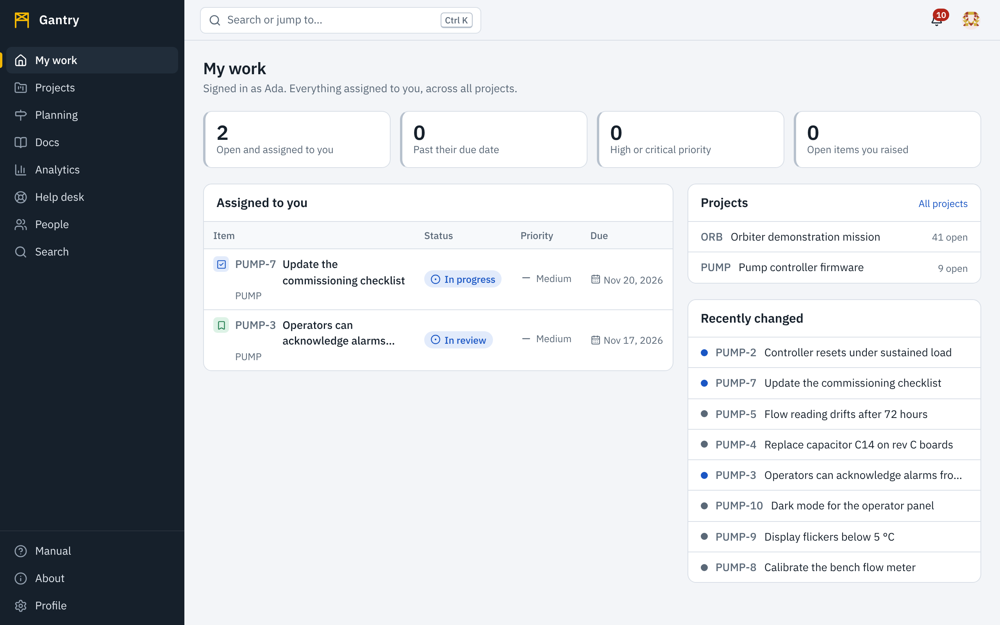

## My work

**Assigned to you** lists the open items where you are the assignee, highest priority first. A red date is overdue. Select a row to open the item.

**Recently changed** shows what happened lately in the projects you can see, so you can catch up without opening each board.

**Projects** lists the projects you belong to, for quick access.

The page keeps itself up to date: when someone assigns you work or moves one of your items, the lists change without a reload.

## The bell

The bell at the top shows a count when something involves you, and a short message appears at the bottom of the screen at the moment it happens. Open the bell to read the list; selecting an entry takes you to the item, page or request. Opening the list marks everything in it as read.

What you are told about, and whether it also reaches you by email, is yours to choose. See [Notifications](notifications.md).
