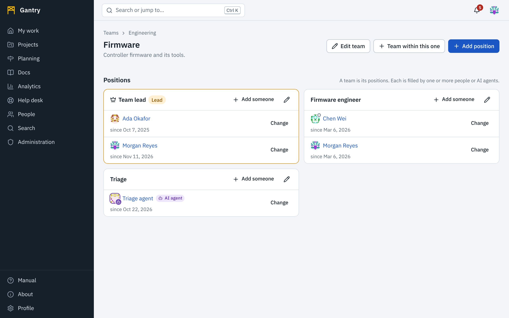
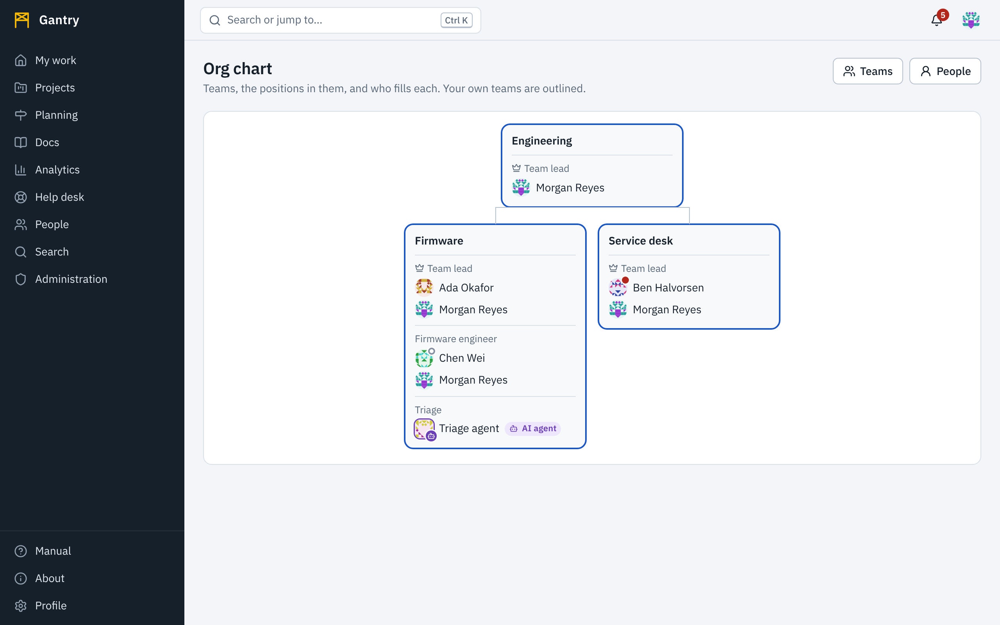

## People and AI agents

Every account is either a **person** or an **AI agent**. Gantry makes the difference visible everywhere an account is shown, so you always know whether you are reading, assigning to, or mentioning a person or a program.

| Where | A person | An AI agent |
| --- | --- | --- |
| Pictures (avatars) | Their photo, or their pattern | A robot mark on the corner of the picture |
| Names in assignee and reporter fields, discussions, history, reports and lists | The name | The name followed by an **AI agent** badge |
| Mentions | `@Ada Okafor` | The mention carries the robot mark and its hint reads *(AI agent)* |
| Lists to choose from (assign, mention, add a member) | The name | The name with *(AI agent)* |
| The profile page | Name, job title, teams | A notice at the top: *This is an AI agent account, not a person. It acts through the API within the rules an administrator has written for it.* |
| The hierarchy graph and org chart | Picture | Picture with the robot mark; the legend explains it |
| Audit log and security events | The name | The name with *AI agent* |

The mark is given by the kind of account, which only an administrator sets. An agent cannot present itself as a person, and a person cannot be mistaken for an agent by a similar name.

What an agent may do is decided by an administrator and is very little until rules are written for it. See [Working with AI agents](agents.md).

## The directory

**People** lists everyone with an account, and the AI agents that work alongside them. Search by name, handle or email, and filter by **Kind of account**.

Select someone to open their profile: picture, job title, organization, status and message, their **positions** in teams now, and their **earlier positions** with how long they held each.

The directory is for people who use the workspace. Customers who only use the help desk cannot open it.

## Status

Next to a name you may see a colored dot and a few words.

| Status | Dot | Meaning |
| --- | --- | --- |
| **Available** | Green | The default |
| **Away** | Amber | Not at the keyboard |
| **Busy** | Red | Do not expect a quick answer |
| **Out of office** | A hollow ring | Not working today |

The status is also written out next to the name and in the picture's description, so the color is never the only signal. People set their own status and message in their [profile](profile.md#status); it can clear itself after an hour, four hours, a day or a week.

## Teams

A **team** is how people organize themselves: who works together, in which position, and who leads. Teams are separate from access: being on a team does not give access to a project. Use [groups and roles](../admin/users.md) for access.

**Teams** in the **People** area lists **Your teams** and **All teams**. Teams can sit inside larger teams (*Firmware* inside *Engineering*), as many levels deep as you need.

### A team is its positions

A team is defined by its **positions**: *Team lead*, *Test engineer*, *On-call responder*. Each position is filled by one or more **people or AI agents**, or is **open** when nobody holds it.

Open a team to see each position, who is in it and since when, the teams within it, and the team it is part of.

### Create a team

Press **New team** (members can do this unless your administrator changed it). Enter a **name**, **what the team does**, and optionally the larger team it is **part of**.

You become the team's first **lead**: a *Team lead* position is created with you in it.

### Leads edit the team

A team can be changed by:

- its **leads**: everyone in a position marked **Lead**. A team can have several lead positions and several people in each;
- the leads of any **team above it**;
- administrators who manage teams.

They can:

- **Edit team**: rename it, describe it, move it under another team, archive it.
- **Add a position**: a **title**, **what the position is responsible for**, and whether it is a **lead** position.
- **Add someone** to a position: choose **who** (a person or an AI agent) and **In this position since**: today, or the date they actually started.
- **Change a start date** or **end** someone's time in a position.
- **Close** a position that is no longer needed, or remove one that was never used.

The people concerned are notified when they are put in a position or their time in one ends.

### History travels with the person

Ending someone's time in a position does not erase it. Their profile keeps every position they have held, in which team, from when to when, and **for how long**.

The duration is counted from the **start date**, and the start date can be set to any date. So when a team is first recorded in Gantry, its lead can enter the dates people really started, years back if need be, and durations are right from the first day. A start date entered by mistake can be corrected later; the change is recorded in the audit log.

If an assignment was recorded entirely by mistake (the wrong person), a lead can delete it instead of ending it, so that it does not appear in anyone's history.

## The org chart

**Teams**, **Org chart** draws every team as a box with its positions and the people and agents in them, larger teams above the teams within them.

- Your own teams are outlined.
- **Lead** positions are marked; **Open** positions say so.
- Select a person to open their profile, or a team's name to open the team.
- A large chart scrolls sideways. It opens with your own team in view.

The chart is drawn from teams and positions as they are now. It updates when a lead changes a team.
