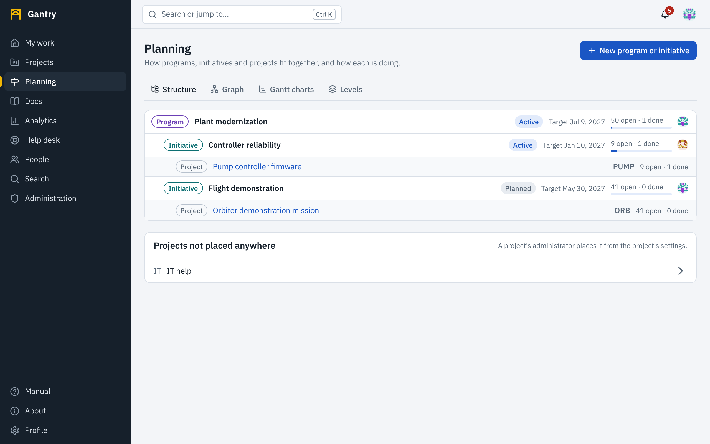
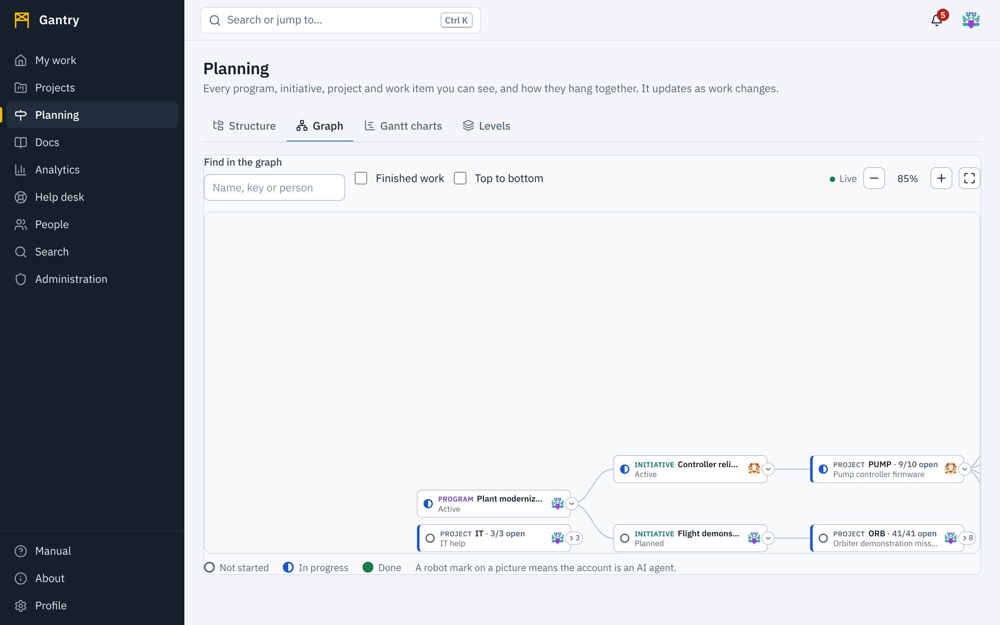
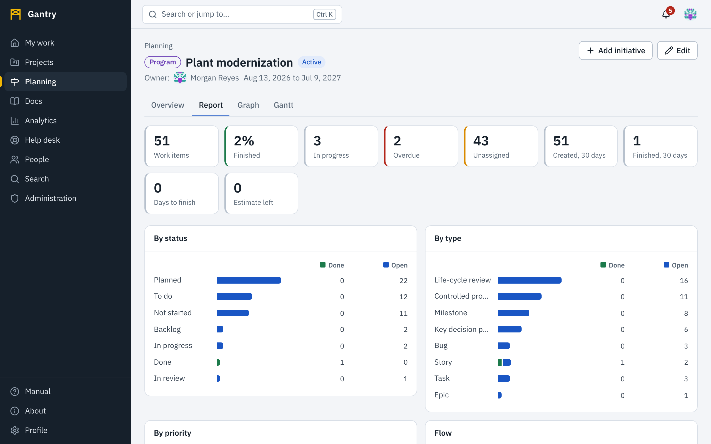

A project holds work items. **Planning** is about what is above and inside projects: which program a project belongs to, how work nests, and how each part is doing.

## The hierarchy

Your organization chooses its own levels. Gantry ships with none above projects, so you start by naming them.

- **Above projects** there can be levels such as *Program* and *Initiative*, or *Portfolio*, *Mission*, *Product line*: any names, in any number up to twelve. The things on these levels are simply called by the level's name: "a program", "an initiative".
- **A project** always sits in the middle. It can be placed in one program or initiative, or in none.
- **Within projects**, work items nest through their **parent**: an epic holds stories, a story holds tasks. Each type of work can be given a level so the order is the same everywhere.

So a complete line might read: *Program* → *Initiative* → *Project* → *Epic* → *Story* → *Task*.

### Define the levels

Open **Planning**, then **Levels**. Changing levels needs the *planning.manage* permission, which workspace administrators have; everyone can see how the hierarchy is defined.

1. Under **Above projects**, add a level. Give it a **name** (*Program*), a **plural** (*Programs*) and a **color**. The color marks the level in the structure, the graph and Gantt charts.
2. Add more levels and use the arrows to put them in order, highest first.
3. Under **Within projects**, do the same for the levels of work, for example *Epic*, *Story*, *Task*.
4. Under **Which level each type of work is on**, choose a level for each work item type. A type with **No level** can sit anywhere.
5. Press **Save**.

**Refuse a parent that is not on a higher level than its child** makes the order a rule: a task can then be placed under a story or an epic, never the other way around. When it is off, the levels are a guide, and any work item can be the parent of any other. Work that already breaks the rule when you turn it on is left as it is; the rule applies to changes made from then on.

Removing a level that is in use is refused, with a message that says what still uses it.

## The structure

**Planning**, **Structure** shows the levels above projects as a tree: each program with its initiatives and projects. Each line has its status, its target date, its owner, and how much of the work beneath it is open and done, as numbers and as a thin bar. A program's numbers add up everything beneath it that you can see.

**Projects not placed anywhere** are listed at the bottom.

### Create a program or initiative

Press the **New …** button at the top right. It names your own levels, for example **New program or initiative**. It needs *planning.manage*; the owner of a program can add what is beneath it from the program's page.

| Field | Meaning |
| --- | --- |
| **Level** | Which of your levels it is on. |
| **Name** | One line. |
| **What it is for** | A description, in Markdown like everything else. |
| **Status** | *Planned*, *Active*, *On hold* or *Done*. Set by hand; it says what the owner intends, while the progress bar says what the work shows. |
| **Beneath** | The program or initiative above it, when there is a higher level. |
| **Starts** and **Target date** | Shown on Gantt charts as a span. The target date cannot be before the start. |
| **Owner** | The person accountable for it. The owner can edit its details and add what is beneath it, and can open every project beneath it and read its reports, including projects they are not a member of. Choose owners with that in mind. |

### Place a project

A project's administrator places it: open the project, **Settings**, **Lead and place in the hierarchy**, and choose **Part of**. From a program's page, **Place a project here…** does the same for projects you administer.

The same section sets the **project lead**. The lead is shown on the project, in the graph and in reports, and can always open the project's report.

## A program's page

Select a program or initiative to open it.

- **Overview**: its description, dates, owner, what is beneath it and its projects, each with progress.
- **Report**: statistics over all the work beneath it. See [Reports](#reports).
- **Graph**: the hierarchy graph, starting here.
- **Gantt**: every work item beneath it on a timeline. See [Gantt charts](gantt.md).

**Archive this program** (the button names the level) hides it from the structure without touching its projects.

## The graph

**Planning**, **Graph** draws everything you can see as one picture: programs at the top, their initiatives, their projects, and each project's work items by parent and child.

Each node shows:

- its **name** (and for work items the key);
- its **status**, as a ring around the node: gray for not started, blue for in progress, green for done, with the status named for screen readers and in the legend;
- the **picture of the person it is assigned to**, or of the owner or lead. An AI agent's picture carries a robot mark. An unassigned node shows an empty circle.

The graph is **live**: when someone moves a work item, reassigns it, creates one or re-parents one, the node changes color, picture or place while you watch. The green dot marked **Live** above the graph confirms the connection.

**Select a node** to open a panel with more: status, type, priority, assignee, reporter, due date, dates, labels, when it last changed, and how much work it holds. **Open** in the panel takes you to the item, project or program; closing the panel returns you to the graph where you were.

Getting around:

| To | Do |
| --- | --- |
| Move | Drag the background |
| Zoom | The **+** and **−** buttons (the percentage between them is the current zoom), or hold <kbd>Ctrl</kbd> and scroll |
| See everything | **Fit the whole graph** |
| Find something | Type a name, key or person in **Find in the graph**; matches are outlined, the rest fades, and the number of matches is shown |
| Fold a branch | The small arrow at the edge of a node hides or shows what is beneath it; a folded node shows how many it hides |
| Include finished work | Select **Finished work**. It is left out at first so that the picture shows what is still to do. |
| Turn the picture | Select **Top to bottom** to draw the hierarchy downward, not left to right |

Every node is a button, so the whole graph can be walked with <kbd>Tab</kbd> and opened with <kbd>Enter</kbd>.

In a large workspace, projects start folded so the picture stays readable; open the ones you care about. The graph draws at most the 3,000 most recently changed work items; open a single program or project (its **Graph** tab) to see all of its work.

You see only what you have access to. A program is drawn with the projects you may see; the others are not hinted at, in the graph, in the structure or in the numbers.

## Reports

A report answers "how is this going, and who is doing it?" for one project or for everything beneath a program or initiative.

Open a project's **Report** tab, or a program's **Report** tab.

| Section | Shows |
| --- | --- |
| **Key figures** | Work items in total; finished; in progress; overdue; unassigned; created and finished in the last 30 days; average days from creation to completion over the last 90 days; estimate left. |
| **By status**, **By type**, **By priority** | Done and open work in each group, as bars with the numbers beside them. |
| **Flow** | Work created and finished in each of the last weeks, as a chart and as a table. |
| **By project** | For a program: the same split for each project beneath it. |
| **Who is doing the work** | Every person and AI agent with work assigned here: open, overdue, finished in 30 days, estimate left, and how many changes they made in 30 days. |
| **Most active, last 30 days** | The accounts that made the most changes. |
| **Late, and due soon** | Open work that is past its due date or due within two weeks. |

### Who can read a report

- A **project's** report: people whose role in the project includes *See statistics and workload reports* (project administrators have it), and the **project lead**.
- A **program's or initiative's** report: its **owner**, and the owner of anything above it. It covers the projects beneath it.
- Anyone else who opens a program's report sees figures only for the projects they could read a report for on their own. The report says how many of the projects they can open were left out; projects they cannot see at all are not counted or mentioned anywhere.

Reports name people and how much each has done, so reading one is recorded in the audit log.

For figures you design yourself, see [Dashboards and visualizations](analytics.md).
