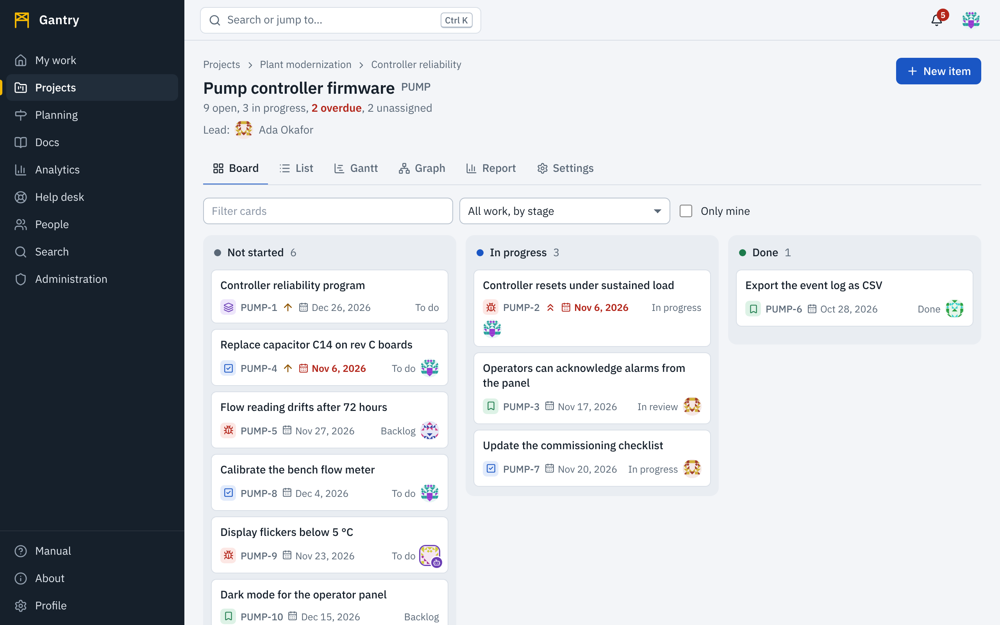

## Open a project

**Projects** shows the projects you can see. Each card shows the project's key (the prefix of its item keys), how many of its items are open, and its lead.

A project has several views, chosen with the tabs under its name. The line under the name shows the project's **lead** and the program or initiative it is **part of**, when those are set.

| View | Use it to |
| --- | --- |
| Board | See work by status and move it forward. |
| List | Filter, sort and scan everything, including finished work. |
| Gantt | See work on a timeline and change dates by dragging. See [Gantt charts](gantt.md). |
| Graph | See how the project's work items hang together as parents and children, live. See [the graph](planning.md#the-graph). |
| Report | Statistics for the project and who is doing the work. Shown to people who may read the project's reports. See [Reports](planning.md#reports). |
| Queues | Service desk projects only: requests grouped for the team that answers them. See [Service desk](service-desk.md). |
| Settings | Change members, cycles, workflows, the lead and the place in the hierarchy and, for a service desk, request types and targets. Shown to project administrators. |

While you have a project open, the top of the page shows who else has it open and which view they are on, and the views update as work changes. See [Working at the same time](together.md).

## The board

Each column is a status and each card an item. A card shows the item's type, key, priority when it is high, due date and assignee.

- **Move an item** by dragging its card to another column. Columns the item's workflow does not allow fade while you drag. On a touch screen use the **Move to…** list on the card. With the keyboard, press <kbd>Tab</kbd> to reach a card and <kbd>Tab</kbd> once more for the same list, which appears when the card has focus.
- **Filter** with the box above the board, or select **Only mine**.
- When a project has several kinds of work with different workflows, the board opens on **All work, by stage**: three columns (Not started, In progress, Done) that every kind of work fits into. Use the list next to the filter to see one workflow with every one of its statuses as a column.

## The list

The list shows the same items as rows. Filter by status, type and assignee, and sort by priority, due date, most recently updated or key. Finished items appear here when you choose **Done** or **All**.

## Cycles

A cycle is a time box such as a sprint or a month. If the project uses cycles, give an item a cycle on its page; the list can then be filtered to one cycle. Project administrators create and close cycles in **Settings**.

## Create a project

You need the *Create projects* permission; members have it unless your administrator changed that.

1. On **Projects** press **New project**.
2. Enter a **name** and a short **key**: two to ten capital letters or digits, starting with a letter. The key cannot be changed later because it is part of every item's address.
3. Choose a **template**; they are grouped by discipline. A template decides the kinds of work, their workflows and a few starter items. There are templates for software, engineering change, research, management, finance, legal, logistics, purchasing, safety and service desks; the full list is in the [catalog](../reference/catalog.md).
4. Choose **who can see it**: everyone in the workspace, or only the members you add.
5. Press **Create project**. You become its administrator.

## Members and roles in a project

In **Settings**, **Members**, a project administrator adds people, AI agents or whole groups and gives each a role. Only accounts that have access to the project can be assigned its work. For an AI agent, membership is necessary but not sufficient: the agent's own [rules](agents.md#how-agents-fit-in) must also allow the project and the action.

| Role | Can |
| --- | --- |
| Viewer | Read everything in the project. |
| Member | Create and edit items, move them, assign, comment, attach files, link. |
| Service agent | Everything a member can, plus answering customers and writing internal notes. |
| Administrator | Everything, plus settings, members and archiving. |

In a project that *everyone in the workspace* can see, people without a role in it can still read it, create items and comment, so that anyone can report a problem or ask a question. Changing, moving and assigning items needs the Member role.

The exact permissions of each role are listed in [Permissions and roles](../reference/permissions.md).

## Project settings worth knowing

- **Workflows**: each type of work in the project follows the shared workflow of that type, or a workflow of the project's own that you draw. See [Workflows](workflows.md).
- **Lead and place in the hierarchy**: name the project lead and place the project in a program or initiative. See [Planning](planning.md#place-a-project).
- **Cycles**: create and close the project's time boxes.

Posting a project's events to a Slack or Microsoft Teams channel, and connecting a repository, are set up by an application administrator under Administration, Integrations, where an integration can be limited to one project. See [Integrations](../admin/integrations.md).
