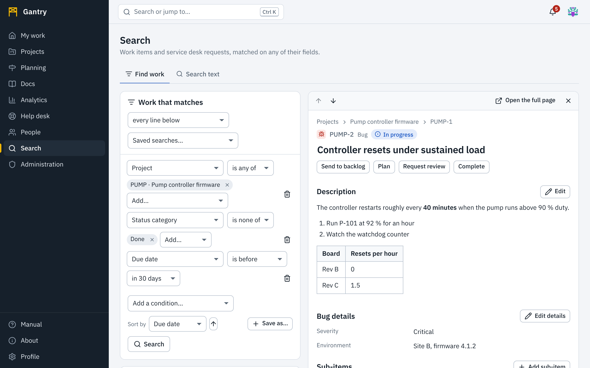

There are three ways to find things.

| You know | Use |
| --- | --- |
| A key, or part of a title | **Quick search**, from anywhere |
| Facts about the work: who, when, which status, which label, any field | **Find work** |
| Words that appear somewhere in an item or a page | **Search text** |

## Quick search

Press <kbd>Ctrl</kbd> <kbd>K</kbd> (<kbd>⌘</kbd> <kbd>K</kbd> on a Mac), or select the box at the top. Start typing: matching items, pages and projects appear at once. Use the arrow keys and <kbd>Enter</kbd> to open one. Typing a complete key such as `PUMP-12` goes straight to that item.

## Find work

Open **Search**. The **Find work** tab matches work items and service desk requests on any combination of their fields.

### Build a search

1. Choose a field under **Add a condition…**. A line appears for it.
2. Choose how to compare and what to compare with. The choices fit the field: people are chosen from a list, dates from a calendar, statuses and labels from the ones that exist.
3. Add more lines. **How the lines combine** decides whether work must match **every line below** or **at least one line below**.
4. Press **Search**, or <kbd>Enter</kbd>.

Each line reads as a sentence, for example *Assignee is any of Me*, *Due date is before Mar 31, 2026*, *Label has all of safety, firmware*.

| Field | Compare with |
| --- | --- |
| **Key**, **Name**, **Description**, **Name or description** | contains, does not contain, starts with, is, is not |
| **Project**, **Type**, **Status**, **Status category** (not started, in progress, done), **Created through** | is any of, is none of |
| **Priority**, **Estimate** | is, is not, is more than, is at least, is less than, is at most, is empty, is not empty |
| **Assignee**, **Reporter** | is any of, is none of, is empty, is not empty. **Me** is always in the list. |
| **Cycle**, **Request type**, **Program or initiative** | is any of, is none of, is empty, is not empty |
| **Created**, **Updated**, **Resolved**, **Start date**, **Due date** | is on, is before, is after, is on or before, is on or after, is between, is empty, is not empty |
| **Label** | is any of, has all of, is none of, is empty, is not empty |
| **Parent** | is (a key), is empty, is not empty |
| **Followed by** | me |
| **Overdue**, **Missed a service-level target**, **Has a parent**, **Has files** | yes or no |
| **Custom fields** | Every field your organization has defined, with comparisons that fit its kind: text, number, date, check box, choice, several choices, or person |

**Dates can be relative.** Besides a calendar date you can choose *today*, *yesterday*, *7 days ago*, *30 days ago*, *90 days ago*, *tomorrow*, *in 7 days* or *in 30 days*. A saved search with *Due date is before today* means "overdue" on whatever day it runs.

A line without a value is left out of the search, and the page says so.

### The results

Results are a list with the **Key**, **Name**, **Status**, **Priority**, **Assignee**, **Due** date and when each item was last **Updated**.

- **Sort** by selecting a column heading; select it again to reverse. The **Sort by** control does the same and also offers created date, type, project and reporter.
- The list shows 50 results at a time; **Previous** and **Next** page through the rest, and the total is shown.

### Open an item without leaving the list

Select a row. The item opens **beside the list**: its description, fields, discussion and history, all usable. The list stays where it was, with the open row marked.

- The two arrows at the top of the panel, **Previous in the list** and **Next in the list**, step through the results.
- Change the status or assignee in the panel and the row updates.
- **Open the full page** opens the item on a page of its own.
- **Close and return to the list** (the ✕) closes the panel.

On a phone or a narrow window the item covers the list; closing it returns you to the same place in the results.

The address in your browser holds the whole search, the sort order and the open item. Copy it to send someone exactly what you are looking at; they will see the same search, with the results **they** have access to.

### Save a search

Press **Save as…**, name the search and press **Save**.

- **Saved searches…** above the lines opens any of yours, and the ones others shared.
- **Share with the workspace** lets everyone open it. Everyone who opens a shared search sees only the work they themselves have access to.
- **Tell me when new work matches** turns the search into an alert: you get a notification when a work item starts to match, by email as well if you chose that for *Saved search alerts* in your profile. With a saved search open, **Alert me** switches this on and the button then reads **Alerting**.
- After changing the lines, **Update** saves them under the same name. **Delete** removes the saved search.

Saved searches also feed [dashboards](analytics.md#getting-project-data): a chart script can run the same criteria.

## Search text

The **Search text** tab finds words in work items and pages.

| Control | Choices |
| --- | --- |
| What to search | Everything, work items only, or pages only. |
| How to match | **Best match** combines the two methods below. **Exact words** finds the words you typed. **Similar meaning** finds text about the same thing even when it uses different words. |

Put a phrase in double quotes to require it exactly. Put a minus sign before a word to exclude it: `pump -spare`.

*Similar meaning* is available when your administrator has turned on semantic search.

## What search will not show

Search only returns what you are allowed to open. Archived items, internal notes on service desk requests and drafts you cannot edit are left out. If you expected a result and it is missing, you probably do not have access to its project or space. Neither kind of search says how many things matched that you may not see.
