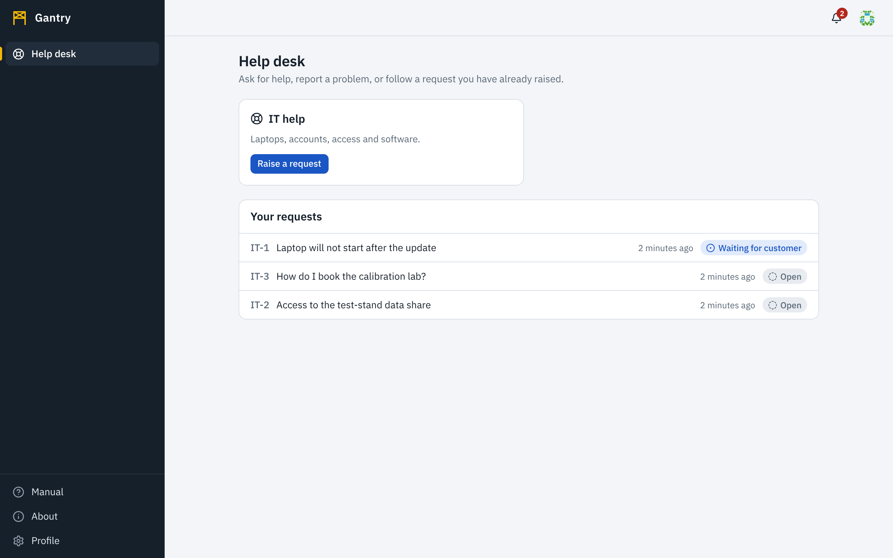
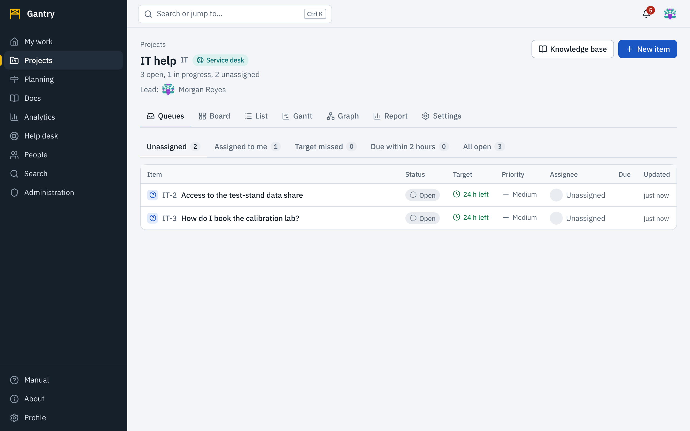

A service desk is a project that takes requests from people outside the team: employees asking IT for a laptop, a site reporting a fault, a customer asking a question. The person asking uses the **help desk**; the team answers from the project's **queues**.

## Asking for help

1. Open **Help desk**. You see the desks open to you.
2. Choose a desk, then the kind of request, for example *Something is broken*.
3. Enter a **summary** and the **details**. While you type, articles from the desk's knowledge base that may already answer your question appear beside the form.
4. Press **Send request**. You get a reference such as `IT-42`.

**Your requests** lists everything you have raised with its current status. Open one to read replies and to add a reply of your own. You see the conversation with the team; you do not see the team's internal notes or their other work.

A request's details and replies are written with the same editor as everything else: you can attach screenshots, recordings and other files with **Attach files** or by pasting them, show a picture in the text, and format with Markdown. See [Writing](writing.md). Each reply shows who wrote it, whether that account is a person or an AI agent, and the date and time in your own time zone.

You are told about replies and status changes in the bell, and by email if you [chose that](notifications.md).

## Answering requests (agents)

> **Note**: in a service desk, an *agent* is a member of the team that answers requests. That is a role in the desk, held by people. It is not the same thing as an **AI agent** account, which is always marked with a robot and the words *AI agent*. An AI agent account can be given the service agent role, like a person can.

Open the service desk project and choose **Queues**.

Each queue is a view of the desk's requests with a count: **Unassigned**, **Assigned to me**, **Target missed**, **Due within 2 hours** and **All open**. Within a queue, requests closest to missing a target come first.

Open a request to work on it:

- **Assign** it to yourself in the side panel so that others know it is taken.
- **Reply to the customer** in the message box and press **Send reply**. The customer is notified and can answer. Mentions, links to work items, files, pictures and everything else in [Writing](writing.md) work here too.
- Select **Internal note (the requester cannot see it)** to write something only the team can read; the button then reads **Add internal note**. Internal notes have a distinct background and a label, are never shown in the help desk, never sent to chat integrations, never emailed to anyone outside the team and never appear in search results for customers. A link in a reply to a work item the customer cannot see is shown to them as plain words.
- Move the request with the step buttons: **Start work**, **Ask customer** (waiting for their answer), **Resolve**, then **Close**. **Reopen** brings a resolved or closed request back.

## Service-level targets

A desk can promise a **first response** and a **resolution** within a set time, by priority. Each request shows its targets as chips.

| Chip | Meaning |
| --- | --- |
| Blue, with time left | On track. |
| Amber | Less than two hours left. |
| Red, *Overdue* | The target was missed. The assignee is notified when this happens. |
| Green, *Met* | Done within the target. |
| Red, *Missed* | Done, but late. |

The first-response clock stops at the first reply to the customer. The resolution clock stops when the request reaches a finished status. Targets can run around the clock or only in working hours; the project administrator chooses in the project's settings.

## Knowledge base

A service desk has a documentation space of the *knowledge base* kind. A page there marked **Shown in the help desk** is offered to customers as they write a request. See [Documentation](docs.md).
