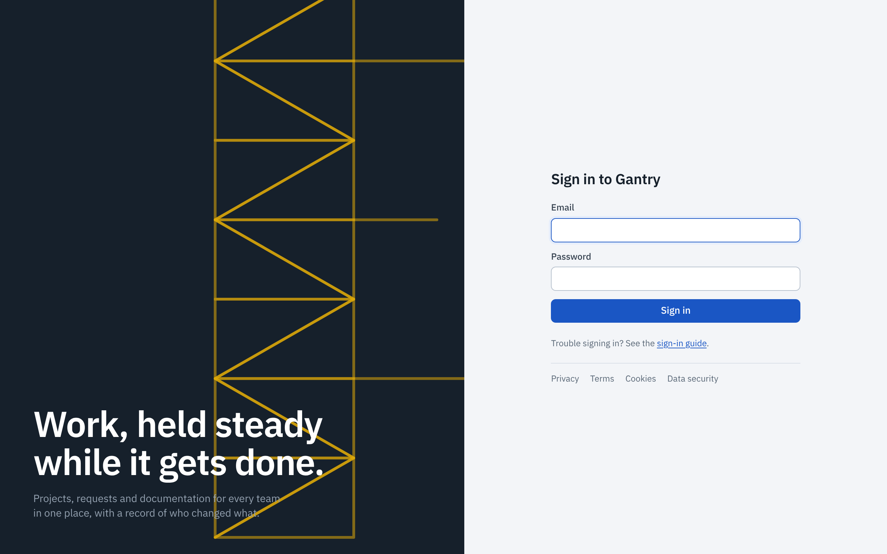

## Sign in

Open the address your organization uses for Gantry. You are taken to the sign-in page.

- If you see a button such as **Continue with Entra ID** or **Continue with Okta**, use it. You sign in at your organization's own page, with its usual second factor, and come back signed in. Gantry never sees that password. It makes no difference to you whether your organization connected Gantry with OpenID Connect or with SAML: the button works the same way.
- Otherwise enter your **email** and **password** and press **Sign in**.

After signing in you land on the page you originally asked for, or on My work.

## Sign out

Open the account menu (your initials, top right) and choose **Sign out**. On a shared computer always sign out: closing the tab is not enough.

You are signed out automatically after a period without activity, and in any case after a number of days. Your administrator sets both.

## Change your password

Open **Profile**, then **Password**. Enter the current password and a new one. Changing it signs out your other devices. If your organization uses single sign-on you have no Gantry password; change it with your identity provider instead.

## When signing in fails

| What you see | What it means | What to do |
| --- | --- | --- |
| *That email and password do not match an active account* | The email or the password is wrong, the account is deactivated, or it is locked. Gantry does not say which, so that nobody can test which addresses have accounts. | Check for a typing mistake or Caps Lock. If it keeps failing, wait fifteen minutes (an account locks for a short time after repeated wrong passwords) or ask an administrator to reset the password. |
| *Too many attempts from this network* | Many failed sign-ins came from your network address in a few minutes. | Wait five minutes and try again. |
| *Single sign-on did not complete* | The sign-in at your identity provider was canceled or refused, or your account is not allowed to use Gantry. | Try again. If it repeats, contact your IT help desk. |
| You sign in but see only the help desk | Your account is a customer account. | If you should work in projects, ask an administrator for the Member role. |
| *Your session has ended* | You were signed out after inactivity or by an administrator. | Sign in again. Unsaved text in an editor is kept in the page until you leave it. |
