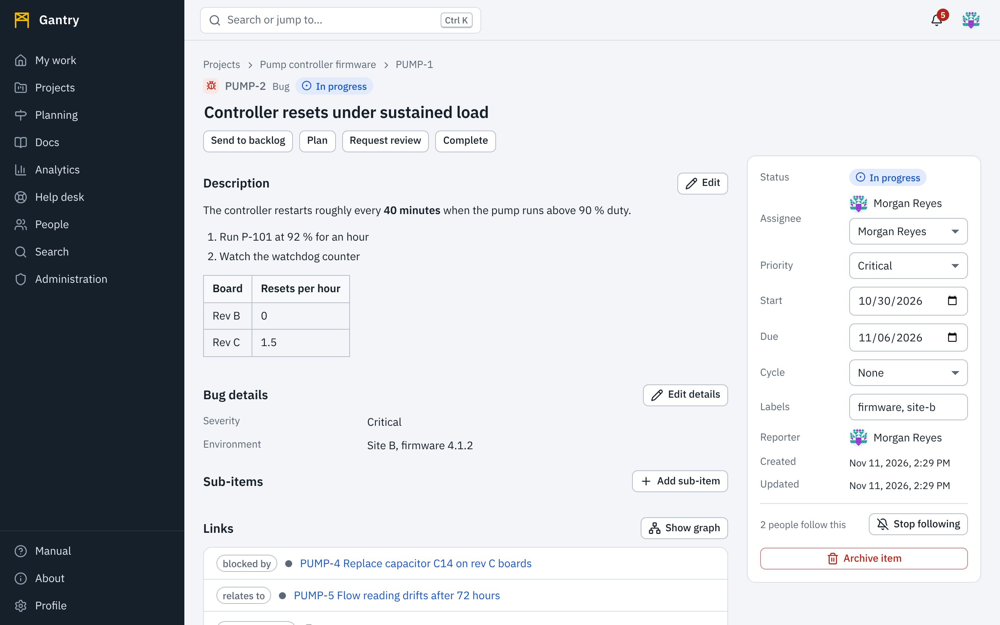
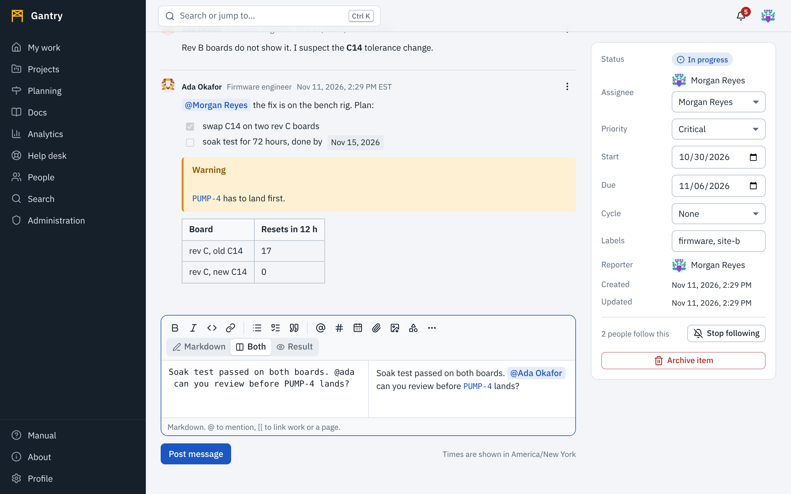

## Create an item

1. In a project press **New item** (or press it on My work and choose the project).
2. Choose the **type**. The form changes to show the fields that type needs; fields marked with an asterisk are required.
3. Enter a **title** that still makes sense out of context: *Controller resets under sustained load*, not *Reset bug*.
4. Optionally set the assignee, priority and due date, then press **Create**.

## The item page

The header shows the type, key, current status and the title. Below it are the buttons for the **next steps** the workflow allows from here.

The main column holds the description, the type's own fields, sub-items, links, files and the conversation. The panel on the right holds who and when: status, assignee, priority, due date, cycle, labels, reporter and dates. On a phone the panel comes after the main column.

Everything saves as you change it, except longer text, which has its own **Save** button.

## Move an item forward

Press one of the step buttons under the title, for example **Start** or **Request review**. Only the steps allowed from the current status are shown.

Some steps need information first. If you press **Submit for review** on a change request without a justification, Gantry tells you which field is missing and leaves the item where it is. Fill the field in under the type's details and press the step again. Hovering over a step button shows what it needs.

## Who and when

The panel on the right holds the facts that boards, searches, reminders and Gantt charts work from.

- **Assignee**: one person or AI agent. Only accounts that have access to the project can be chosen. An AI agent is marked with a robot and the words *AI agent*.
- **Start date** and **Due date**: select the field and pick a day from the calendar your browser opens, or type the date. A due date cannot be earlier than the start date. Dates are calendar days: the 31st is the 31st for everyone, whatever their time zone.
- **Priority**, **Cycle** and **Labels**.
- **Reporter**: who raised it. Created and Updated show the moment in your own time zone; hover for how long ago.

## Describe the work

Press **Edit** next to the description. Descriptions, messages and pages are all written with the same editor, in Markdown, with a live view of the result. [Writing](writing.md) explains the editor: mentions, links to other work, dates, files, pictures, diagrams and charts.

If a colleague opens the same description while you are editing it, you write in the same text and see each other's cursors. See [Working at the same time](together.md). **Save description** publishes the text. **Close without saving** leaves what you typed as a draft for whoever opens the description next; **Discard changes** removes it.

## Talk about it

The **Discussion** tab under the description is the conversation about this piece of work: questions, progress, decisions.

- Write in the box and press **Post message** (<kbd>Ctrl</kbd> <kbd>Enter</kbd> also posts).
- Type `@` to **mention** someone: a list of people and AI agents appears as you type. A mentioned person is notified, if they are able to open the item.
- Type `[[` to **link** a work item, a project or a page by its key or name. You can only link what you can see, and readers who may not see the target see plain words instead of a link.
- Use the paperclip to **attach files**, or paste or drop them into the box. Pictures, sound and video are shown in the message; other files become links.
- Messages are grouped by day. Each shows the **date and time it was written, in your time zone**; hover over the time to see how long ago that was. The line under the box says which time zone is in use.
- New messages from others appear as they are posted. You do not need to reload.

Open the menu on one of your own messages to **Edit** or **Remove** it. An edited message is marked *(edited)*. A removed message leaves the line *This message was removed* so the conversation still makes sense. People who moderate the project's discussions can remove other people's messages; nobody can edit someone else's.

People who reported the item, are assigned to it or [follow](notifications.md#follow-something) it are told about new messages.

## History

The **History** tab lists everything that has happened to the item, newest first: who did it, when, and what changed from what to what.

It records the creation; every change of title, description, status (with the step that was taken), assignee, priority, dates, estimate, cycle, labels, parent and each of the type's own fields; every message posted, edited or removed; every file attached or deleted; every link added or removed; a missed service-level target; and archiving. For a description, **Show what changed** opens the old and new text side by side with the differences colored.

A change made by an AI agent carries the agent's name and the *AI agent* mark. A change made from a Gantt chart, a board or the API is recorded the same way as one made on this page. History cannot be edited.

## Link related work

Under **Links**, choose the relation, enter the other item's key and press **Add link**.

| Relation | On the other item it reads |
| --- | --- |
| relates to | relates to |
| blocks | blocked by |
| duplicates | duplicated by |
| derives from | source of |
| verifies | verified by |
| mitigates | mitigated by |
| threatens | threatened by |
| raised at | raised here |
| waives | waived by |
| changes | changed by |
| documented in | documents |

Links to items you may not see are not shown to you.

**Sub-items** break a large item into smaller ones. Press **Add sub-item** on the parent's page; the new item appears there with its own status.

## Files

Press **Attach files** in the **Files** section and choose one or more files, or attach them from the editor while writing. Every file attached to the item is listed here with its size, who added it and when.

Pictures, sound, video and PDF files open in the browser; sound and video get a small player with play, pause, seek and volume. Everything else is downloaded. No attached file can run scripts in Gantry, whatever it contains. Your administrator sets the size limit for one file (25 MB unless changed).

To show an attached picture or play an attached recording inside a description or message, see [Writing](writing.md#files-pictures-sound-and-video).

## Archive

**Archive** removes an item from boards, lists and search while keeping its history in the database and the audit log. There is no button to bring an archived item back, so archive only what is truly finished with or was created by mistake; to close ordinary work, move it to its final status instead.
