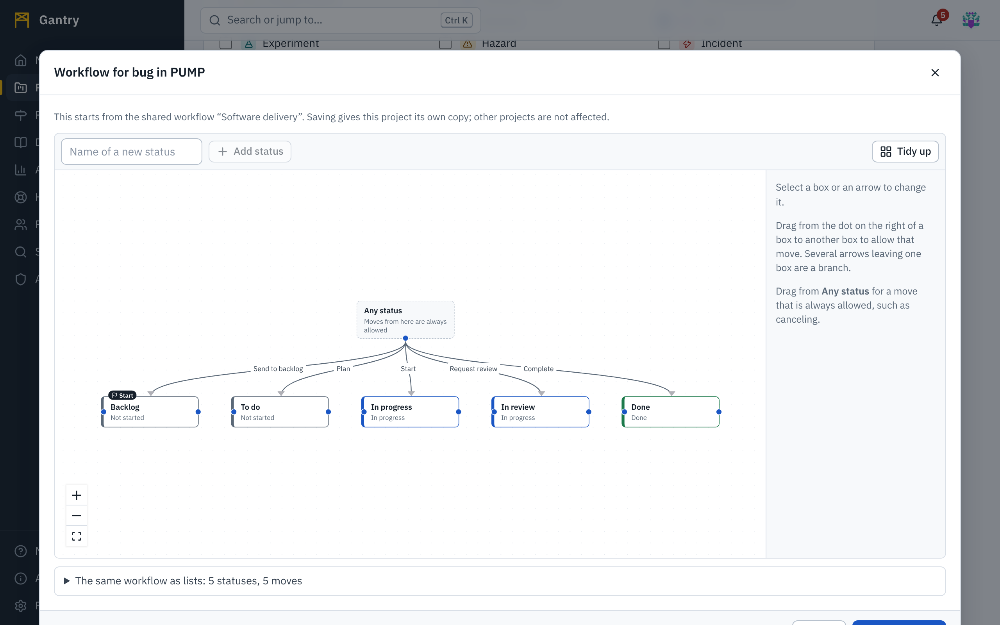

A **workflow** says which statuses a kind of work can be in and which moves between them are allowed. The step buttons on a work item (**Start**, **Request review**, **Done**) are the moves its workflow allows from where it is now.

Workflows are drawn, not typed.

## Who designs which workflow

| Workflow | Used by | Designed by | Where |
| --- | --- | --- | --- |
| **Shared workflows** | Every project that uses the type | Application administrators | Administration, Types and workflows |
| **A project's own workflow** for one type of work | That project only | The project's administrators | The project, Settings, Workflows |
| **A space's page stages** | Pages in that space | The space's administrators | The space, Space settings, Stages a page goes through |

A project starts with the shared workflow of each of its work item types. Giving a type its **own workflow** in a project copies the shared one as a starting point; later changes to the shared one no longer reach that project. **Use the shared workflow** returns to it.

## The canvas

Each **box** is a stage (a status). Each **arrow** is a move that is allowed. Work flows from left to right.

- The box marked **New work starts here** is where new items begin.
- A box's color shows what it **counts as**: *Not started* (gray), *In progress* (blue) or *Done* (green). This is what boards, reports and progress bars count by, and it is written on the box as well.
- **Several arrows leaving one box are a branch**: from *In review*, work can go on to *Done* or back to *In progress*.
- The box **Any status** above the row stands for "from anywhere". An arrow from it is a move that is always allowed, such as canceling.

## Design a workflow

1. **Add a stage**: type its name in **Name of a new status** and press **Add status**. Drag the box to where it belongs.
2. **Allow a move**: drag from the dot on the right of a box to another box. Name the move in the panel at the side: the name is what people see on the button, so write it as an action (*Start*, *Send for review*, *Approve*).
3. **Branch**: draw a second arrow from the same box.
4. **Allow a move from anywhere**: drag from **Any status** to the target.
5. **Select a box** to rename it, choose what it counts as, or make it the place where new work starts.
6. **Select an arrow** to rename the move or to choose fields that **must be filled in first**. A move with required fields is refused until they have values, and the button's hint tells people which ones.
7. Press **Tidy up** to lay the boxes out in the order work flows, if the canvas has become untidy.
8. Press **Save workflow**.

The same workflow is listed as two tables beneath the canvas, one of the stages and one of the moves, with every control available there too. The tables are the way to design a workflow with the keyboard or a screen reader, and they are quicker for small corrections.

### What the editor checks

The **Save** button is unavailable, and the reason is shown, while:

- a stage or a move has no name, or two stages would get the same key;
- no stage is marked as the start;
- no stage counts as done;
- a move leads to or from a stage that was removed.

Two warnings do not stop you from saving, because they are sometimes intended:

- *Nothing leads to …: work can never get there.*
- *Nothing leads out of …, and it does not count as done: work would stay there.*

A workflow can have up to 60 stages and 400 moves.

## Changing a workflow that is in use

Changing names, adding stages and adding or removing moves takes effect at once for all the work that uses the workflow.

**Removing a stage** that work may be sitting in needs a decision. When you save, Gantry lists each removed stage and asks where its work goes: *Work in Blocked moves to …*. The move is carried out when you confirm and is recorded in each work item's history, so nothing is ever left in a status that no longer exists.

Returning a project's type to the shared workflow asks the same question for statuses the shared workflow does not have.

## Page stages in a documentation space

A documentation space uses the same editor for the stages a page goes through before readers see it. **Define stages** starts from *Draft → In review → Published* with the moves *Send for review*, *Send back*, *Publish* and *Revise*, which you can change. A page becomes visible to readers when it reaches a stage that counts as done. See [Documentation](docs.md#stages-before-publishing).

## Good practice

- Keep it small. Five stages that everyone understands beat twelve that nobody follows.
- Name stages as states (*In review*) and moves as actions (*Send for review*).
- Use required fields to capture what the next person needs, not everything you might want.
- Add one "from anywhere" move for stopping work (*Cancel*), so nothing is ever stuck.
