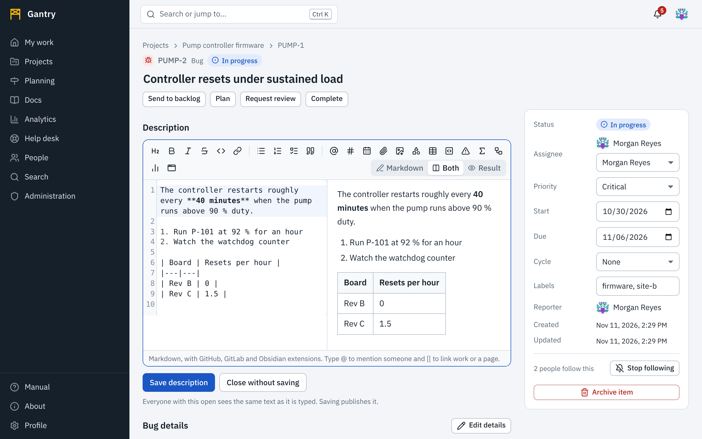
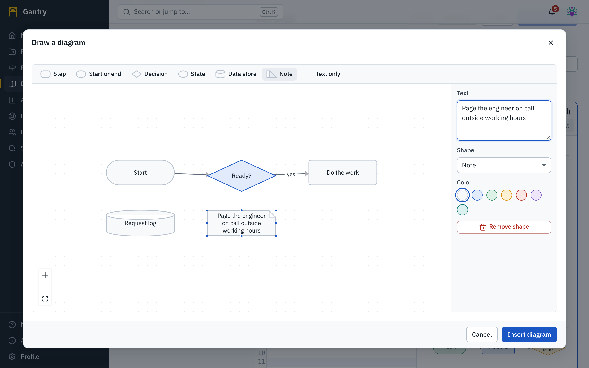
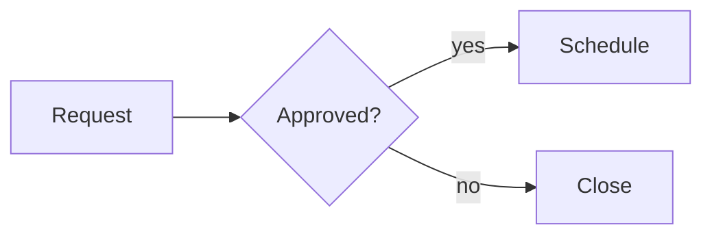

Descriptions, discussion messages, service desk replies and documentation pages are all written with the same editor and stored as **Markdown**: plain text with a few marks, which Gantry shows formatted. What you learn in one place works in the others.



## Three views

The switch at the right of the toolbar chooses what you see while writing.

| View | Shows | Use it when |
| --- | --- | --- |
| **Markdown** | The text as typed, marks and all. | You know Markdown and want the most room. |
| **Both** | The text on the left, the result on the right, updating as you type. | You are learning, or checking a table or diagram. On a narrow screen the result is shown beneath the text. |
| **Result** | Only how it will read. | A last look before saving. |

Your choice is remembered per kind of editor in this browser. Small editors, such as the message box, start in **Markdown**.

You never have to type the marks: every button in the toolbar writes them for you, and you can see the plain Markdown at any time by switching views.

## The toolbar

| Button | Writes | Shortcut |
| --- | --- | --- |
| Heading | `## ` at the start of the line | |
| Bold, Italic, Strikethrough, Code | `**bold**`, `*italic*`, `~~struck~~`, `` `code` `` | <kbd>Ctrl</kbd> <kbd>B</kbd>, <kbd>Ctrl</kbd> <kbd>I</kbd> |
| Link | `[text](https://…)` | <kbd>Ctrl</kbd> <kbd>K</kbd> |
| Bulleted list, Numbered list, Checklist, Quote | `- `, `1. `, `- [ ] `, `> ` | |
| **Mention someone** | `@handle` | type `@` |
| **Link a work item or page** | `[[PUMP-12]]` | type `[[` |
| **Insert a date** | `[[2026-03-31]]` | |
| **Attach files** | a link or picture for each file | paste or drop |
| **Image size** | a width on the picture under the cursor | |
| **Draw a diagram** | a diagram block | |
| Table, Code block, Callout, Formula, Diagram from text (Mermaid), Chart from a script, HTML or SVG | a starting block of each kind. In small editors these are together under **More to insert**. | |

On Macs use <kbd>⌘</kbd> where this page says <kbd>Ctrl</kbd>. <kbd>Ctrl</kbd> <kbd>Enter</kbd> posts a message or saves, wherever the editor has such a button. <kbd>Tab</kbd> indents; to move on to the next control with the keyboard, press <kbd>Esc</kbd> and then <kbd>Tab</kbd>. More in [Keyboard and accessibility](accessibility.md).

## Mention people

Type `@` and the first letters of a name or handle. Choose from the list with the arrow keys and <kbd>Enter</kbd>. AI agents are in the list too, marked as such.

A mention becomes a link to the person's profile and **notifies** them. Two rules protect privacy:

- you can mention only accounts you are able to see in the directory;
- a person is notified only if they are able to open the thing they were mentioned on.

A handle that matches nobody stays plain text.

## Link work, projects and pages

There are three ways, and they can be mixed:

- **Type a key.** `PUMP-12` anywhere in the text becomes a link; hover over it to see the item's title.
- **Type `[[`** and start typing a key, a title, a project or a page name; choose from the list. `[[PUMP-12]]` shows the key and title, `[[PUMP-12|the seal problem]]` shows your own words, `[[PUMP]]` links the project and `[[Release process]]` links the page with that title.
- **Embed a card.** `![[PUMP-12]]` on a line of its own shows the item as a small card with its status.

> **Important**: you can link only what you are allowed to see. When the text is saved, Gantry checks every link against **your** access; when it is shown, against the **reader's**. A reader without access sees the plain words, with no title, status or hint that the target exists.

`#word` becomes a tag, shown as a chip.

## Dates

Press **Insert a date** to open a calendar. Move with the arrow keys (<kbd>Page Up</kbd> and <kbd>Page Down</kbd> change the month), press <kbd>Enter</kbd> or select a day, and the date is written as `[[2026-03-31]]`. Readers see it written out in their own language's style, for example *Mar 31, 2026*. **Today** inserts today's date.

A date in text is a calendar day. It is the same day for every reader.

## Files, pictures, sound and video

Attach with the paperclip, or **paste** from the clipboard, or **drop** files onto the editor. Each file is uploaded to the item, request or page you are writing on, and a line is written for it:

| File | What is written | What readers see |
| --- | --- | --- |
| A picture | `` | The picture |
| Sound (`mp3`, `m4a`, `ogg`, `wav`, `flac`, `opus`) | `` | A player: play, pause, seek, volume |
| Video (`mp4`, `m4v`, `webm`, `ogv`, `mov`) | `` | A player with the same controls, and full screen |
| Anything else | `[report.pdf](report.pdf)` | A link that opens or downloads the file |

Inside the text, a file is referred to by its **name**. That works for every file attached to the same item, request or page, so you can also write the line yourself: ``, `[the test log](run-17.log)`, or in the Obsidian style `![[wiring-diagram.png]]`.

The players are your browser's own, so they follow its keyboard controls and captions settings. Whether a recording plays depends on the browser knowing its format; MP4 (H.264 with AAC), WebM and MP3 play everywhere.

Pictures from other websites are **not** loaded into the page: `` is shown as a link. This stops a message from reporting who read it to another server. Attach the picture instead.

### Make a picture smaller

Put the cursor on the picture's line and press **Image size**. Choose **Small** (240 pixels wide), **Medium** (480), **Large** (800) or **Original**, or type a width of your own and press **Set**. The height follows in proportion.

The width is written into the text, in any of these equivalent forms:

```

{width=480}
![[wiring-diagram.png|480]]
![[wiring-diagram.png|480x300]]
```

A picture is never shown wider than the text column, so a large original is safe.

## Diagrams

**Draw a diagram** opens the diagram editor: a canvas for flowcharts and block diagrams.



- A new diagram starts with a small example of three shapes; change them or remove them.
- Add a shape from the bar at the top: **Step** (a box), **Start or end** (rounded), **Decision** (a diamond), **State** (an ellipse), **Data store** (a cylinder), **Note** or **Text only**. A new shape appears beside the selected one, or beneath the drawing when nothing is selected, and never on top of another. Drag to place it; select it and pull a corner to resize it.
- Double-click a shape to type its text, or select it and use the **Text** box at the side.
- Drag from a dot on a shape's edge to another shape to connect them. Select a connection to give it a label, a dashed line, or arrowheads at one end, both ends or neither.
- Give shapes one of seven colors. The colors follow the reader's light or dark theme.
- With the keyboard: <kbd>Tab</kbd> moves between shapes, the arrow keys move the selected one, <kbd>Delete</kbd> or <kbd>Backspace</kbd> removes it.

**Save** writes the diagram into your text as a ` ```diagram ` block. It is part of the text: it is saved, versioned, compared and restored with it. To change a diagram later, put the cursor in its block and press **Draw a diagram** again.

For diagrams that are quicker to type than to draw, **Diagram from text (Mermaid)** inserts a ` ```mermaid ` block. Flowcharts, sequence diagrams, state diagrams, Gantt sketches, class and entity diagrams are supported:

````

````

> **Note**: Gantry's diagram editor is its own. It does not open or save draw.io files. To use a drawing made in another tool, export it as SVG or PNG and attach it as a picture.

## Charts and custom content

Text can contain live charts and your own HTML.

- **A saved visualization.** `![[viz:` followed by its id and `]]` shows a chart from the [visualization library](analytics.md); the library gives you the exact line to copy. Add a height in pixels after a bar: `![[viz:…|320]]`.
- **A chart written in place.** **Chart from a script** inserts a ` ```viz ` block with a starting script. Name the library after `viz`: `chartjs`, `echarts`, `plotly` or `d3`.
- **HTML or SVG.** **HTML or SVG** inserts an ` ```embed ` block. Whatever you put there (markup, styles, SVG, scripts) is shown in a frame of its own.

Charts and embedded content run in a **sealed frame**: they cannot read the page around them, your session or anything else in Gantry, and they cannot contact other servers. A script can only *read* data through the API, as the person looking at it, so every reader sees figures for the work they have access to. [Dashboards and visualizations](analytics.md#write-your-own) explains how to write one.

Add `height=300` after the block's name to fix the height of the frame, for example ` ```embed height=300 `.

Some HTML can be written straight into the text without a frame: `<details>` and `<summary>` for collapsible sections, `<kbd>`, `<sub>`, `<sup>`, `<mark>`, `<abbr>`, tables, and `<video>` or `<audio>` with attached files. Scripts, styles, forms and frames written straight into text are removed; put them in an `embed` block.

## More that works

The editor accepts what people already write in GitHub, GitLab and Obsidian. The full list is in [the Markdown reference](../reference/markdown.md); the ones used most:

````
> [!warning] Check the interlock first
> A callout. Kinds: note, tip, important, warning, caution and more.

| Step | Owner |
|------|-------|
| Test | Ada   |

- [x] a finished task
- [ ] an open one

==highlighted==, {+added+} and {-removed-}

$E = mc^2$ in a sentence, or a ```math block for a formula on its own line.

[[_TOC_]] puts a table of contents here.
````

## When something does not appear

| You see | Why |
| --- | --- |
| A key or name in gray text with a dashed underline | The target does not exist, or you cannot see it. |
| *This diagram could not be drawn* | The Mermaid text has a mistake; the message names the line. |
| A frame with an error message in it | The script in a `viz` or `embed` block failed; the message is the script's error. |
| *This visualization does not exist, or has not been shared with you* | Ask its owner to share it, or use one of your own. |
| A picture shown as a link | It is on another website. Attach it instead. |
